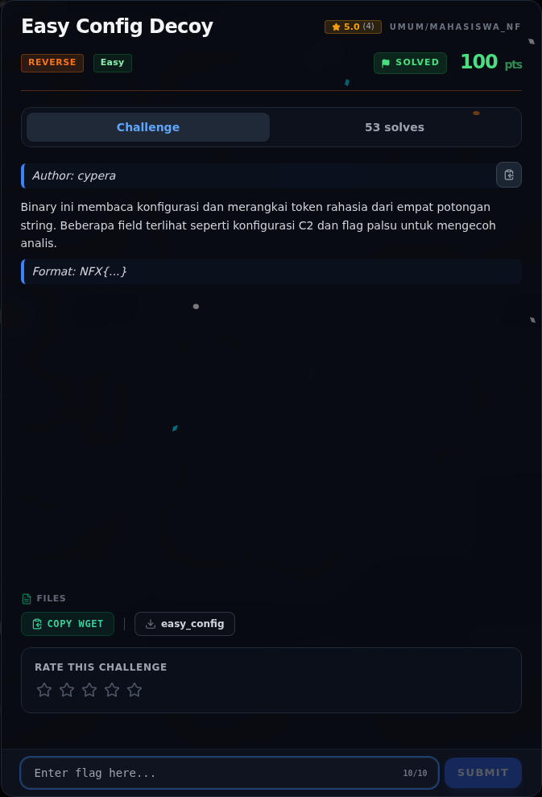

# Easy Config Decoy — Analisis

[← Overview](61-easy-config-decoy.md) · [Index](index.md)

> **Langkah 2/6 — Analisis.** Program merangkai potongan .rodata sesuai urutan pointer.
>
> **Titik penting:** NFX{c0nf + 1g_ + d3c0y_ + p4rts + _ + 4r3_fun} · NFX{...}
>
> **Berikutnya:** [Solver](61-easy-config-decoy-03-solver.md)

Program merangkai potongan `.rodata` sesuai urutan pointer. Kalau potongan asli disambung:

```text
NFX{c0nf + 1g_ + d3c0y_ + p4rts + _ + 4r3_fun}
```

Hasilnya flag asli. Dua string `NFX{...}` yang utuh adalah decoy.

### Evidence langkah ini



*Challenge brief asli di platform NFX CTF 2026.*
