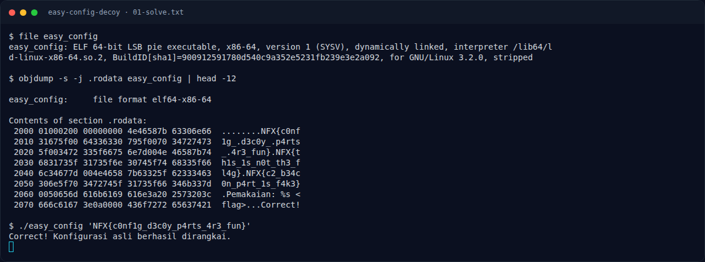

# Easy Config Decoy — Solver

[← Overview](61-easy-config-decoy.md) · [Index](index.md)

> **Langkah 3/6 — Solver.** Kita bisa langsung uji hasil rangkaian ke binary:
>
> **Titik penting:** NFX{c0nf1g_d3c0y_p4rts_4r3_fun} · Correct! Konfigurasi asli berhasil dirangkai.
>
> **Berikutnya:** [Flag](61-easy-config-decoy-04-flag.md)

Kita bisa langsung uji hasil rangkaian ke binary:

```bash
./easy_config 'NFX{c0nf1g_d3c0y_p4rts_4r3_fun}'
```

```text
Correct! Konfigurasi asli berhasil dirangkai.
```

### Evidence langkah ini



*Terminal evidence — `01-solve.txt` (arsip transkrip sesi solve).*

**Berkas mentah langkah ini:**

- [`01-solve.txt`](assets/easy-config-decoy/01-solve.txt)
