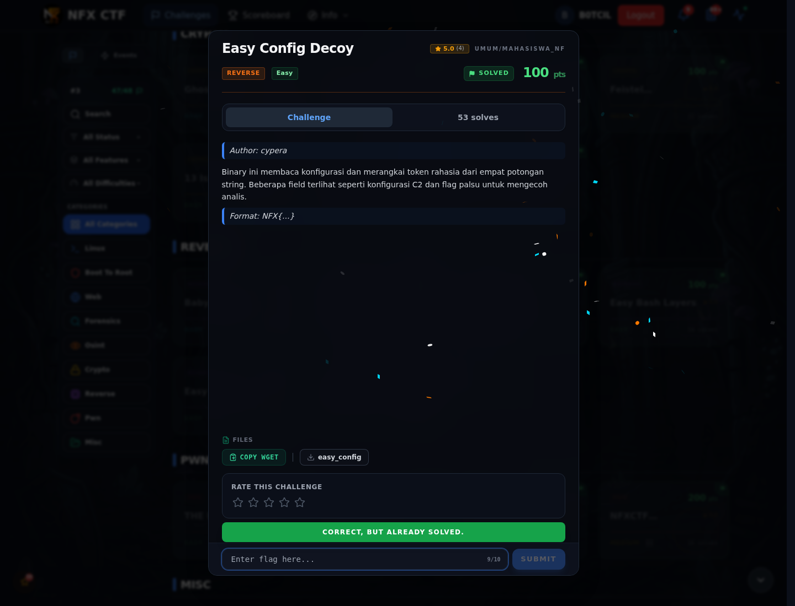

# Easy Config Decoy — Flag & Verifikasi

[← Overview](61-easy-config-decoy.md) · [Index](index.md)

> **Langkah 4/6 — Flag.** Flag
>
> **Titik penting:** NFX{c0nf1g_d3c0y_p4rts_4r3_fun}
>
> **Berikutnya:** [Bukti / Evidence](61-easy-config-decoy-05-bukti-evidence.md)

> **Flag:** `NFX{c0nf1g_d3c0y_p4rts_4r3_fun}`
> **Status:** `VERIFIED`

```text
NFX{c0nf1g_d3c0y_p4rts_4r3_fun}
```

### Bukti submit di platform



*Submit flag di platform: `CORRECT, BUT ALREADY SOLVED.`*

> **Bukti submit:** screenshot form challenge di atas menampilkan `CORRECT, BUT ALREADY SOLVED.`
