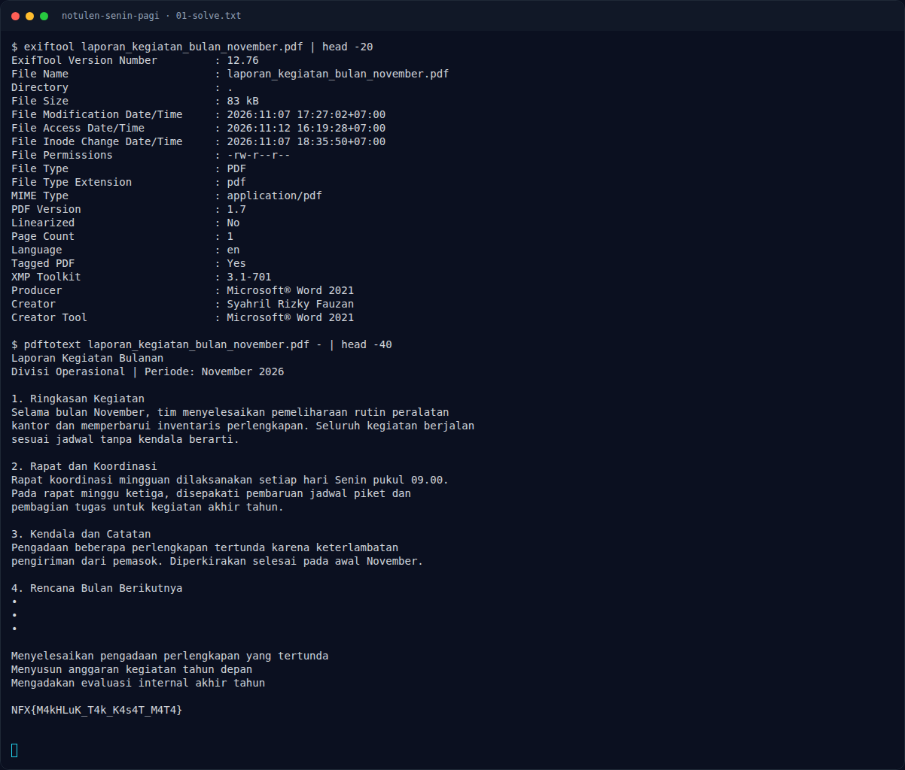

# Notulen Senin Pagi — Jejak awal

[← Overview](62-notulen-senin-pagi.md) · [Index](index.md)

> **Langkah 1/5.** Metadata PDF bersih. Teks visual juga bersih.
>
> **Berikutnya:** [Cara Mendapatkan Flag](62-notulen-senin-pagi-02-cara-mendapatkan-flag.md)

```bash
exiftool laporan_kegiatan_bulan_november.pdf
pdftotext -layout laporan_kegiatan_bulan_november.pdf -
```

EXIF hanya menyebut pembuat `Syahril Rizky Fauzan`. Flag tidak ada di metadata.

### Evidence langkah ini



*Terminal evidence — transkrip langkah — `term-01-solve.png`.*

**Berkas mentah terkait:**

- [`01-solve.txt`](assets/notulen-senin-pagi/01-solve.txt)
