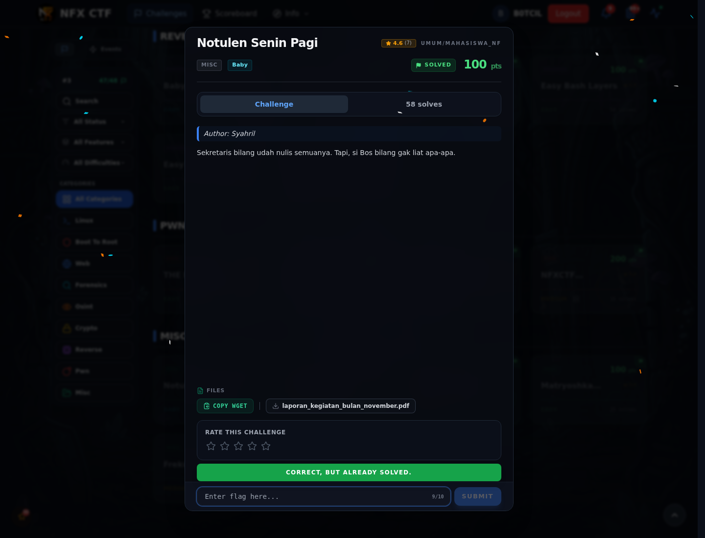

# Notulen Senin Pagi — Flag & Verifikasi

[← Overview](62-notulen-senin-pagi.md) · [Index](index.md)

> **Langkah 2/5 — Cara Mendapatkan Flag.** Cara Mendapatkan Flag
>
> **Titik penting:** NFX{M4kHLuK_T4k_K4s4T_M4T4}
>
> **Berikutnya:** [Flag](62-notulen-senin-pagi-03-flag.md)

> **Flag:** `NFX{M4kHLuK_T4k_K4s4T_M4T4}`
> **Status:** `VERIFIED`

1. Cek metadata dan teks PDF:
```bash
exiftool laporan_kegiatan_bulan_november.pdf
pdftotext laporan_kegiatan_bulan_november.pdf -
```
2. Cari teks putih/transparan, komentar, atau objek di luar halaman.
3. Flag muncul dari teks tersembunyi di laporan.

### Bukti submit di platform



*Submit flag di platform: `CORRECT, BUT ALREADY SOLVED.`*

> **Bukti submit:** screenshot form challenge di atas menampilkan `CORRECT, BUT ALREADY SOLVED.`
