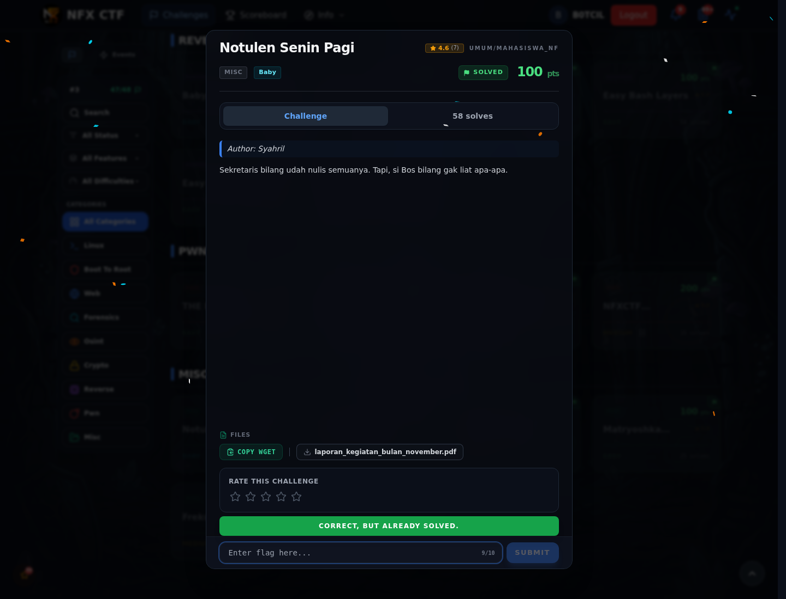

# Notulen Senin Pagi — Flag & Verifikasi

[← Overview](62-notulen-senin-pagi.md) · [Index](index.md)

> **Langkah 3/5 — Flag.** Flag
>
> **Titik penting:** NFX{M4kHLuK_T4k_K4s4T_M4T4}
>
> **Berikutnya:** [Bukti / Evidence](62-notulen-senin-pagi-04-bukti-evidence.md)

> **Flag:** `NFX{M4kHLuK_T4k_K4s4T_M4T4}`
> **Status:** `VERIFIED`

```text
NFX{M4kHLuK_T4k_K4s4T_M4T4}
```

### Bukti submit di platform



*Submit flag di platform: `CORRECT, BUT ALREADY SOLVED.`*

> **Bukti submit:** screenshot form challenge di atas menampilkan `CORRECT, BUT ALREADY SOLVED.`
