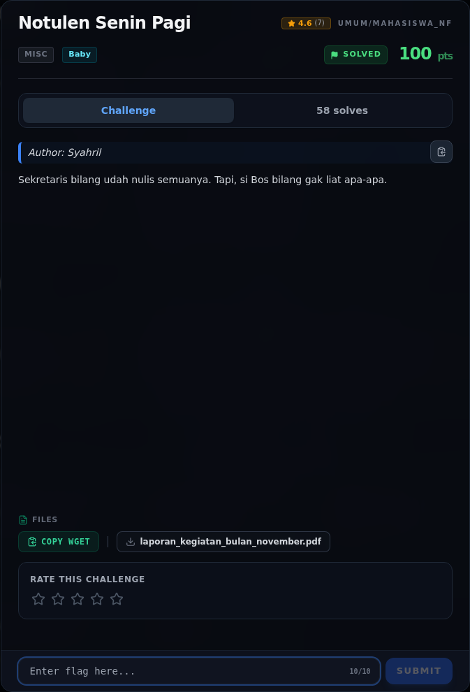
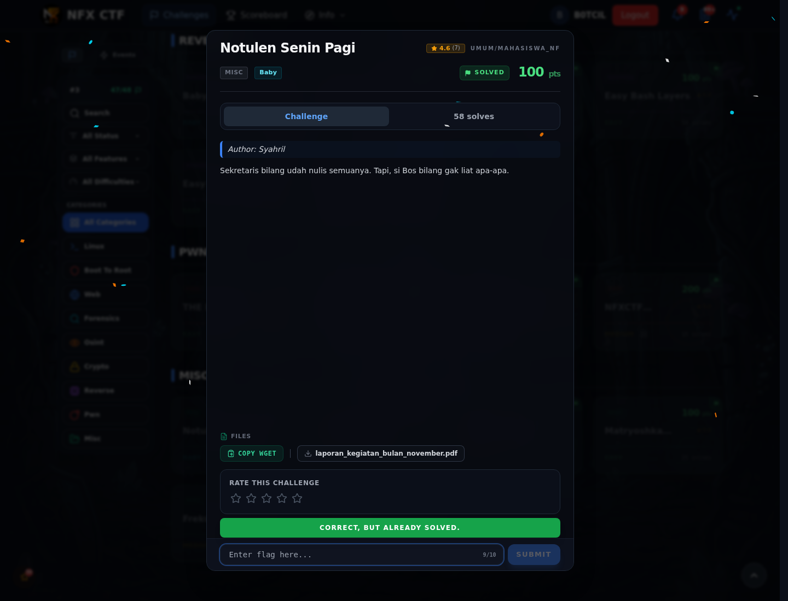
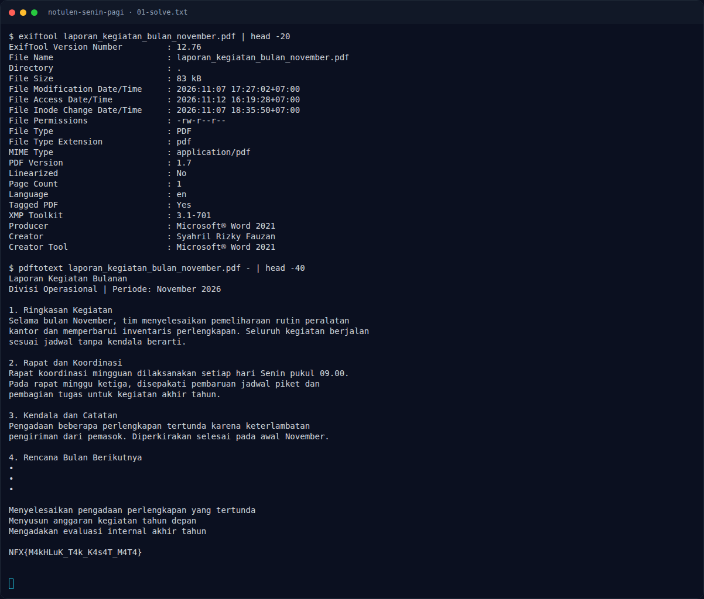

# Notulen Senin Pagi — Evidence / Bukti

3 screenshot1 transkrip / script

[← Overview](62-notulen-senin-pagi.md) · [Index](index.md)

> **Langkah 4/5 — Bukti / Evidence.** Bukti / Evidence
>
> **Titik penting:** arsip screenshot dan transkrip
>
> **Berikutnya:** [Referensi](62-notulen-senin-pagi-05-referensi.md)

## Arsip Evidence

> Semua file berasal dari `assets/notulen-senin-pagi/`. Screenshot platform dan terminal adalah bukti asli dari sesi solve; transkrip mentah tetap ditautkan di bagian bawah.

### Platform

<figure><figcaption>00-challenge-platform.png</figcaption></figure>

*Challenge brief asli di platform NFX CTF 2026.*

<figure><figcaption>00b-submit-platform.png</figcaption></figure>

*Submit flag di platform: `CORRECT, BUT ALREADY SOLVED.`*

### Terminal (arsip sesi)

<figure><figcaption>term-01-solve.png</figcaption></figure>

*Terminal evidence — `01-solve.txt` (arsip transkrip sesi solve).*

### Transkrip mentah & script

- [`01-solve.txt`](assets/notulen-senin-pagi/01-solve.txt)

## Tabel Evidence

- Challenge brief: `assets/notulen-senin-pagi/00-challenge-platform.png`
- Submit web: `assets/notulen-senin-pagi/00b-submit-platform.png`
- Catatan mentah: lihat folder `assets/notulen-senin-pagi/`