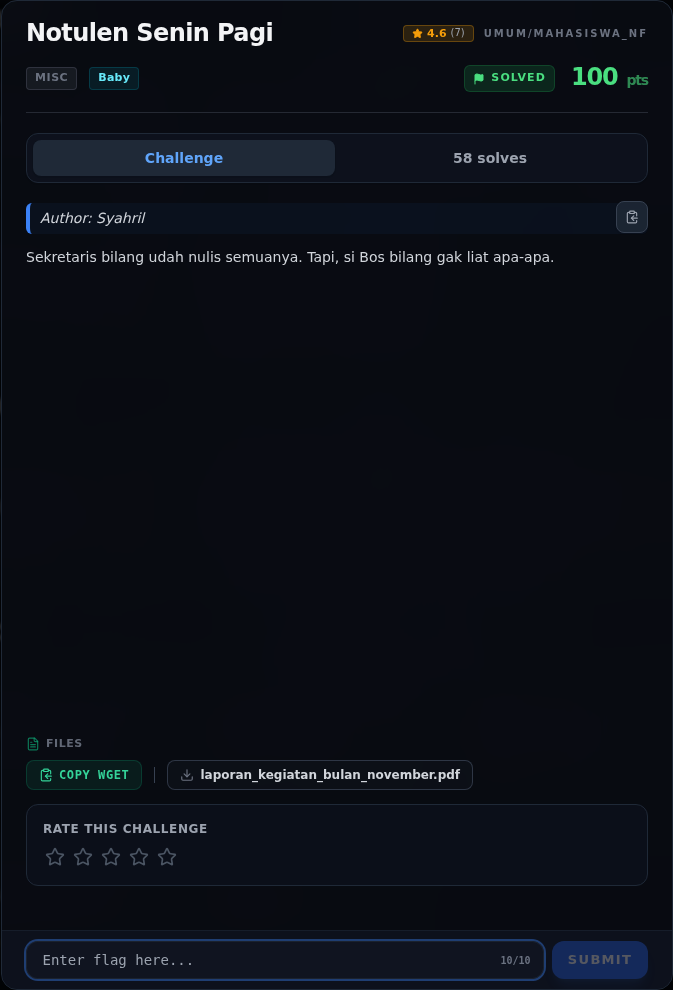
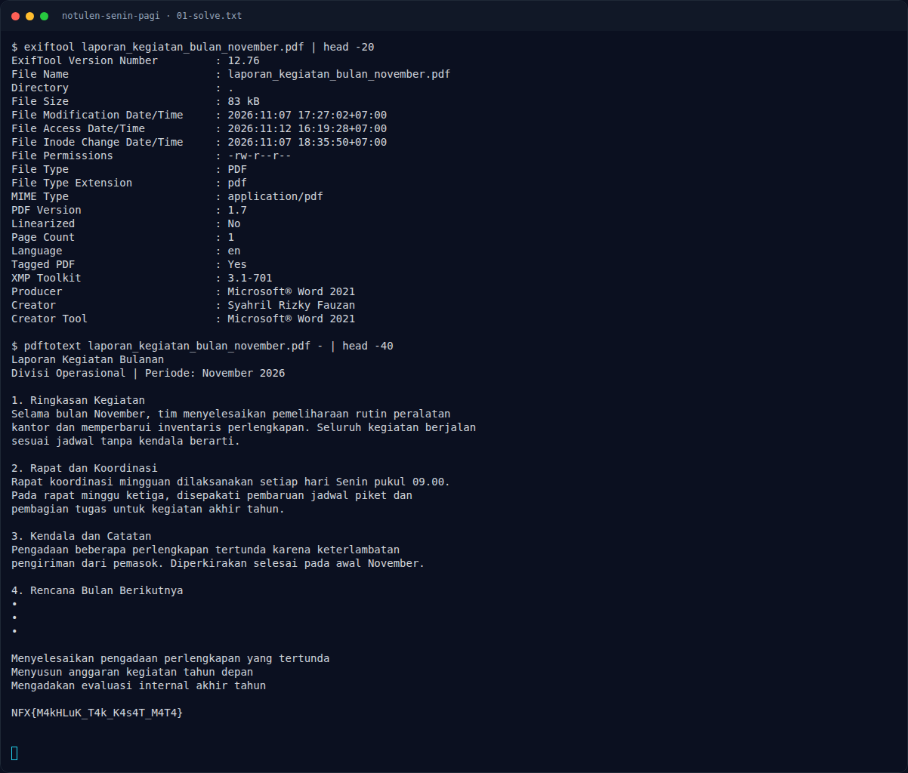

# Notulen Senin Pagi

Track Mahasiswa NF · MiscBaby100 poinVERIFIED

| Field | Nilai |
|---|---|
| Event | `umum/mahasiswa_nf` |
| Kategori | `Misc` |
| Author | `Syahril` |
| Difficulty | `Baby` |
| Poin (snapshot) | `100` |
| Tools | exiftool |
| Flag | `NFX{M4kHLuK_T4k_K4s4T_M4T4}` |
| Status | `VERIFIED` |
| Metode | **FULL** — metode utama berhasil direproduksi. |
| Snapshot | 2026-11-13 |

[← Kembali ke Index](index.md)

## TL;DR

- **Flag:** `NFX{M4kHLuK_T4k_K4s4T_M4T4}`
- **Metode:** **FULL** — metode utama berhasil direproduksi.
- **Baca langkah lengkap:** [Cara Mendapatkan Flag](62-notulen-senin-pagi-02-cara-mendapatkan-flag.md)

## Challenge Brief (platform)

*Challenge brief asli di platform NFX CTF 2026.*

## Alur & Titik Penting

| # | Langkah | Titik penting | Buka |
|---:|---|---|---|
| 1 | Recon | PDF satu halaman, metadata bersih. | [Buka](62-notulen-senin-pagi-01-recon.md) |
| 2 | Cara Mendapatkan Flag | `pdftotext` membaca teks putih. | [Buka](62-notulen-senin-pagi-02-cara-mendapatkan-flag.md) |
| 3 | Flag | NFX{M4kHLuK_T4k_K4s4T_M4T4} | [Buka](62-notulen-senin-pagi-03-flag.md) |
| 4 | Bukti / Evidence | arsip screenshot dan transkrip | [Buka](62-notulen-senin-pagi-04-bukti-evidence.md) |
| 5 | Referensi | PDF text layer, metadata, hidden text. | [Buka](62-notulen-senin-pagi-05-referensi.md) |

## Cerita singkat

Flag tertulis di PDF dengan warna yang tidak kelihatan. `pdftotext` tetap membacanya; mata tidak.

Pratinjau evidence. Buka halaman <a href="62-notulen-senin-pagi-04-bukti-evidence.html">Evidence / Bukti</a> untuk semua screenshot dan transkrip.

## Navigasi Halaman

<a class="nx-page-card" href="62-notulen-senin-pagi-01-recon.html"><b>Recon</b>Enumerasi target dan bukti awal</a>
<a class="nx-page-card" href="62-notulen-senin-pagi-02-cara-mendapatkan-flag.html"><b>Cara Mendapatkan Flag</b>Flag dan verifikasi platform</a>
<a class="nx-page-card" href="62-notulen-senin-pagi-03-flag.html"><b>Flag</b>Flag dan verifikasi platform</a>
<a class="nx-page-card" href="62-notulen-senin-pagi-04-bukti-evidence.html"><b>Bukti / Evidence</b>Screenshot, transkrip, dan artefak</a>
<a class="nx-page-card" href="62-notulen-senin-pagi-05-referensi.html"><b>Referensi</b>Sumber dan bacaan lanjutan</a>

