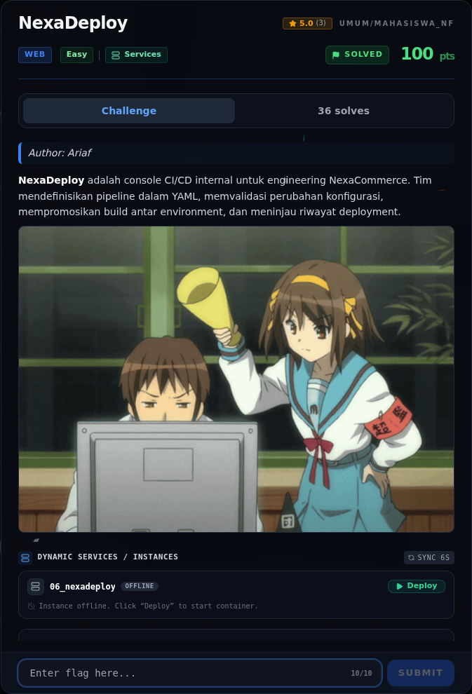

# NexaDeploy — Referensi

[← Overview](63-nexadeploy.md) · [Index](index.md)

> **Langkah 5/5 — Referensi.** Unsafe YAML deserialization, yaml.load vs safeload.
>
> **Titik penting:** Unsafe YAML deserialization, yaml.load vs safeload.
>
> **Selesai.** Kembali ke [Overview](63-nexadeploy.md).

Unsafe YAML deserialization, `yaml.load` vs `safe_load`.

### Evidence langkah ini

*Challenge brief asli di platform NFX CTF 2026.*
