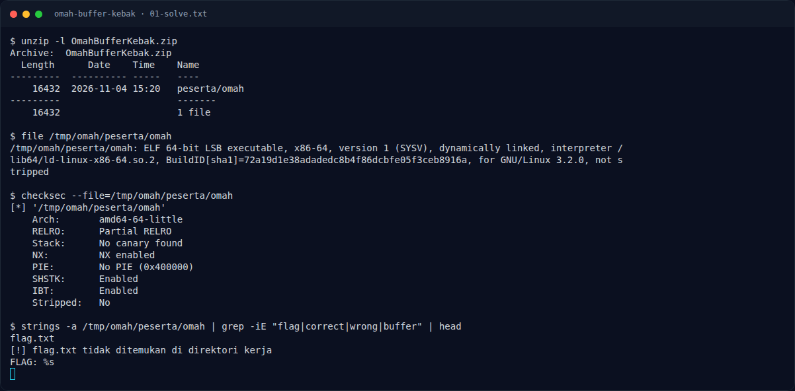

# Omah Buffer Kebak — Jejak awal

[← Overview](64-omah-buffer-kebak.md) · [Index](index.md)

> **Langkah 1/5.** `gets()` menulis ke buffer 0x40 byte. Fungsi flag `obong` ada di `0x40125f`.
>
> **Berikutnya:** [Cara Mendapatkan Flag](64-omah-buffer-kebak-02-cara-mendapatkan-flag.md)

```bash
unzip OmahBufferKebak.zip
nm peserta/omah | grep obong
```

```text
000000000040125f t obong
```

Tidak ada canary. Binary non-PIE. NX menyala, jadi jalurnya ret2win, bukan shellcode.

### Evidence langkah ini



*Terminal evidence — transkrip langkah — `term-01-solve.png`.*

**Berkas mentah terkait:**

- [`01-solve.txt`](assets/omah-buffer-kebak/01-solve.txt)
