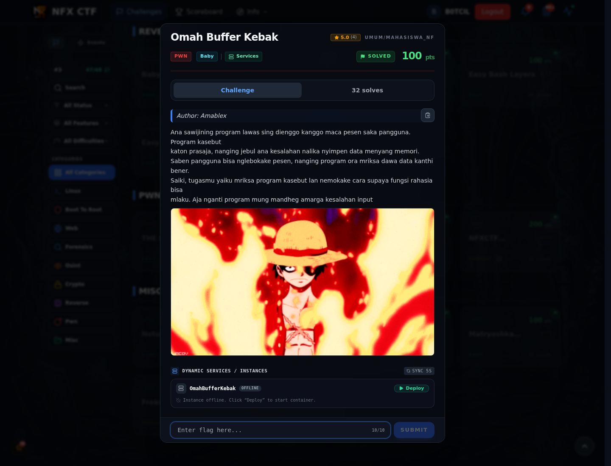
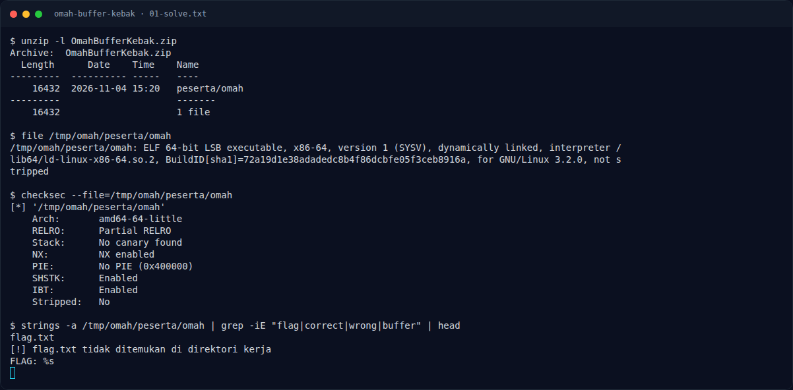
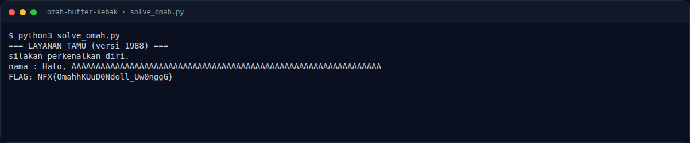
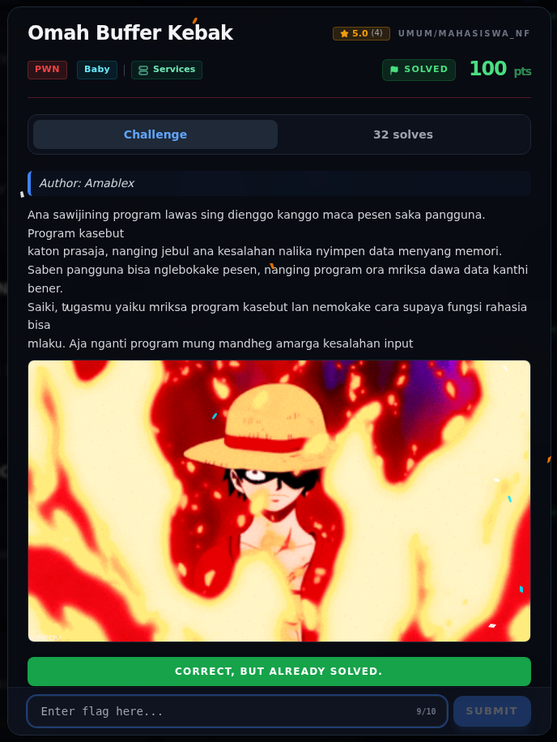

# Omah Buffer Kebak — Evidence / Bukti

4 screenshot2 script / output

[← Overview](64-omah-buffer-kebak.md) · [Index](index.md)

> **Langkah 4/5 — Bukti / Evidence.** Bukti / Evidence
>
> **Titik penting:** arsip screenshot dan transkrip
>
> **Berikutnya:** [Referensi](64-omah-buffer-kebak-05-referensi.md)

## Arsip Evidence

> Semua file berasal dari `assets/omah-buffer-kebak/`. Screenshot platform dan terminal adalah bukti asli dari sesi solve; transkrip mentah tetap ditautkan di bagian bawah.

### Platform

<figure><figcaption>00-challenge-platform.png</figcaption></figure>

*Challenge brief asli di platform NFX CTF 2026.*

<figure><figcaption>Terminal evidence (real)</figcaption></figure>

*Terminal evidence (real).*

### Terminal (arsip sesi)

<figure><figcaption>term-01-solve.png</figcaption></figure>

*Terminal evidence — `01-solve.txt` (arsip transkrip sesi solve).*

<figure><figcaption>10-local-exploit.png</figcaption></figure>

*Output `solve_omah.py` dengan binary asli dan `flag.txt` challenge.*

### Transkrip mentah & script

- [`01-solve.txt`](assets/omah-buffer-kebak/01-solve.txt)
- [`solve_omah.py`](assets/omah-buffer-kebak/solve_omah.py)
- [`10-local-exploit.txt`](assets/omah-buffer-kebak/10-local-exploit.txt)
- [`flag.txt`](assets/omah-buffer-kebak/flag.txt)
- [`omah`](assets/omah-buffer-kebak/omah)

## Validasi platform (real)

*Screenshot asli dari platform NFX CTF 2026. Platform menjawab
`CORRECT, BUT ALREADY SOLVED.` untuk flag ini.*

## Tabel Evidence

- Challenge brief: `assets/omah-buffer-kebak/00-challenge-platform.png`
- Terminal evidence: `assets/omah-buffer-kebak/00b-terminal-evidence.png`
- Binary asli: `assets/omah-buffer-kebak/omah`
- Exploit: `assets/omah-buffer-kebak/solve_omah.py`
- Output lokal: `assets/omah-buffer-kebak/10-local-exploit.txt`
- Terminal output: `assets/omah-buffer-kebak/10-local-exploit.png`
- Validasi platform: `assets/omah-buffer-kebak/00b-platform-validation.png`