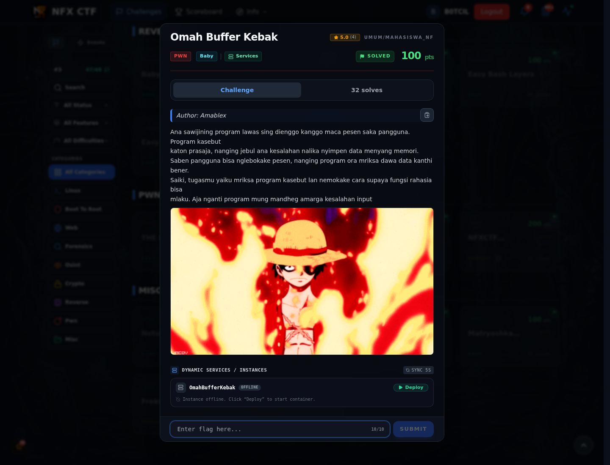

# Omah Buffer Kebak — Referensi

[← Overview](64-omah-buffer-kebak.md) · [Index](index.md)

> **Langkah 5/5 — Referensi.** Buffer overflow, checksec, pwntools cyclic.
>
> **Titik penting:** Buffer overflow, checksec, pwntools cyclic.
>
> **Selesai.** Kembali ke [Overview](64-omah-buffer-kebak.md).

Buffer overflow, checksec, pwntools cyclic.

### Evidence langkah ini

*Challenge brief asli di platform NFX CTF 2026.*
