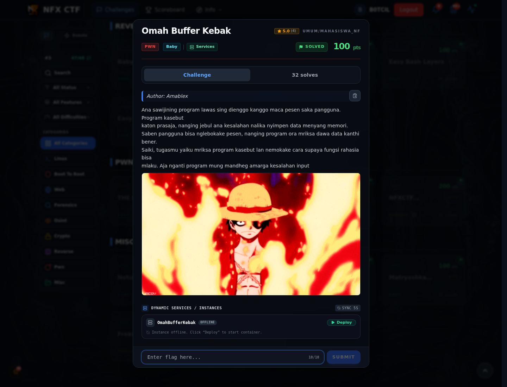
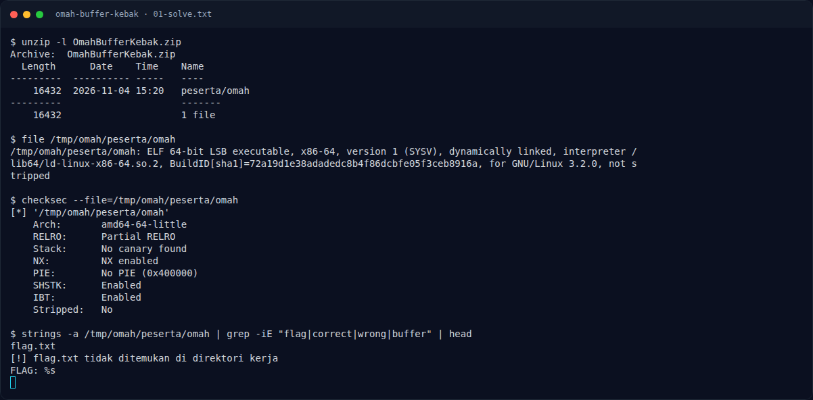

# Omah Buffer Kebak

Track Mahasiswa NF · PwnBaby100 poinVERIFIED

| Field | Nilai |
|---|---|
| Event | `umum/mahasiswa_nf` |
| Kategori | `Pwn` |
| Author | `Amablex` |
| Difficulty | `Baby` |
| Poin (snapshot) | `100` |
| Tools | pwntools, checksec |
| Flag | `NFX{OmahhKUuD0Ndoll_Uw0nggG}` |
| Status | `VERIFIED` |
| Metode | **FULL** — ret2win dengan binary asli; offset `0x48` dan alamat `obong` diverifikasi, output flag nyata. Service remote sudah offline. |
| Snapshot | 2026-11-13 |

[← Kembali ke Index](index.md)

## TL;DR

- **Flag:** `NFX{OmahhKUuD0Ndoll_Uw0nggG}`
- **Metode:** **FULL** — ret2win dengan binary asli; offset 0x48 dan alamat obong diverifikasi, output flag nyata. Service remote sudah offline.
- **Baca langkah lengkap:** [Cara Mendapatkan Flag](64-omah-buffer-kebak-02-cara-mendapatkan-flag.md)

## Challenge Brief (platform)

*Challenge brief asli di platform NFX CTF 2026.*

## Alur & Titik Penting

| # | Langkah | Titik penting | Buka |
|---:|---|---|---|
| 1 | Recon | `gets()` dan `obong` di `0x40125f`. | [Buka](64-omah-buffer-kebak-01-recon.md) |
| 2 | Cara Mendapatkan Flag | Padding `0x48`, lalu ret2win. | [Buka](64-omah-buffer-kebak-02-cara-mendapatkan-flag.md) |
| 3 | Flag | NFX{OmahhKUuD0Ndoll_Uw0nggG} | [Buka](64-omah-buffer-kebak-03-flag.md) |
| 4 | Bukti / Evidence | arsip screenshot dan transkrip | [Buka](64-omah-buffer-kebak-04-bukti-evidence.md) |
| 5 | Referensi | Buffer overflow, checksec, pwntools cyclic. | [Buka](64-omah-buffer-kebak-05-referensi.md) |

## Cerita singkat

`gets()` tanpa batas. Offset ke return address adalah `0x48`. Panggil `obong` di `0x40125f` untuk membaca `flag.txt`.

Pratinjau evidence. Buka halaman <a href="64-omah-buffer-kebak-04-bukti-evidence.html">Evidence / Bukti</a> untuk semua screenshot dan transkrip.

## Navigasi Halaman

<a class="nx-page-card" href="64-omah-buffer-kebak-01-recon.html"><b>Recon</b>Enumerasi target dan bukti awal</a>
<a class="nx-page-card" href="64-omah-buffer-kebak-02-cara-mendapatkan-flag.html"><b>Cara Mendapatkan Flag</b>Flag dan verifikasi platform</a>
<a class="nx-page-card" href="64-omah-buffer-kebak-03-flag.html"><b>Flag</b>Flag dan verifikasi platform</a>
<a class="nx-page-card" href="64-omah-buffer-kebak-04-bukti-evidence.html"><b>Bukti / Evidence</b>Screenshot, transkrip, dan artefak</a>
<a class="nx-page-card" href="64-omah-buffer-kebak-05-referensi.html"><b>Referensi</b>Sumber dan bacaan lanjutan</a>

