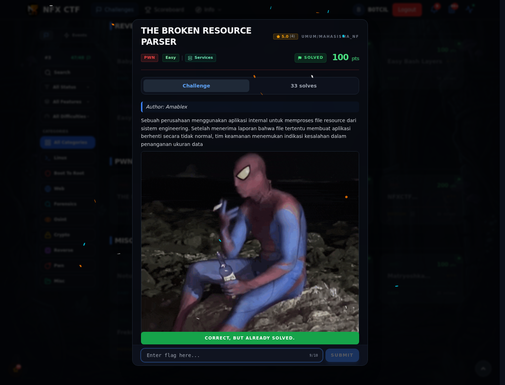

# THE BROKEN RESOURCE PARSER — Flag & Verifikasi

[← Overview](65-the-broken-resource-parser.md) · [Index](index.md)

> **Langkah 2/5 — Cara Mendapatkan Flag.** Cara Mendapatkan Flag
>
> **Titik penting:** NFX{Ad1o0Ssss_Br0k3nnn_fl3gg}
>
> **Berikutnya:** [Flag](65-the-broken-resource-parser-03-flag.md)

> **Flag:** `NFX{Ad1o0Ssss_Br0k3nnn_fl3gg}`
> **Status:** `VERIFIED`

1. Buka attachment, cek format resource dan jalankan binary.
2. Coba input panjang/struktur aneh sampai parser crash.
3. Manfaatkan bug untuk mengontrol alur dan membaca flag.

### Bukti submit di platform

*Submit flag di platform: `CORRECT, BUT ALREADY SOLVED.`*

> **Bukti submit:** screenshot form challenge di atas menampilkan `CORRECT, BUT ALREADY SOLVED.`
