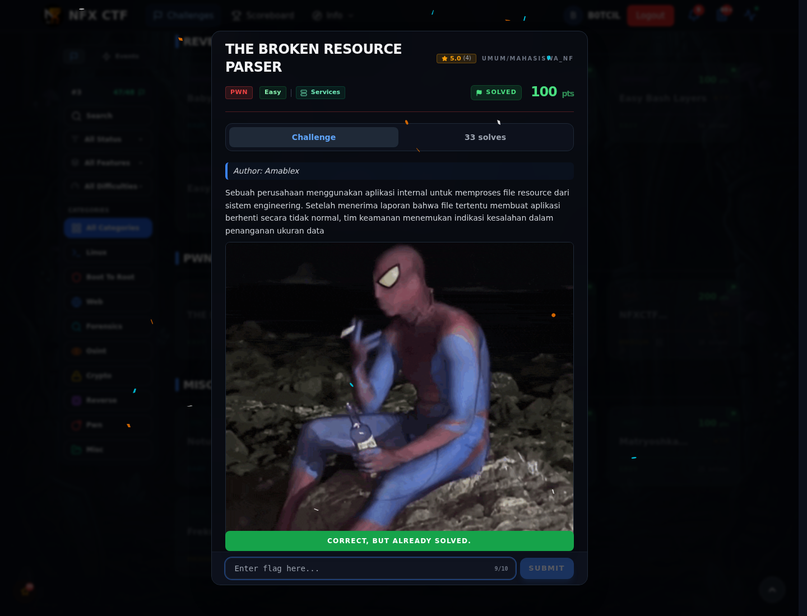

# THE BROKEN RESOURCE PARSER — Flag & Verifikasi

[← Overview](65-the-broken-resource-parser.md) · [Index](index.md)

> **Langkah 3/5 — Flag.** Flag
>
> **Titik penting:** NFX{Ad1o0Ssss_Br0k3nnn_fl3gg}
>
> **Berikutnya:** [Bukti / Evidence](65-the-broken-resource-parser-04-bukti-evidence.md)

> **Flag:** `NFX{Ad1o0Ssss_Br0k3nnn_fl3gg}`
> **Status:** `VERIFIED`

```text
NFX{Ad1o0Ssss_Br0k3nnn_fl3gg}
```

### Bukti submit di platform



*Submit flag di platform: `CORRECT, BUT ALREADY SOLVED.`*

> **Bukti submit:** screenshot form challenge di atas menampilkan `CORRECT, BUT ALREADY SOLVED.`
