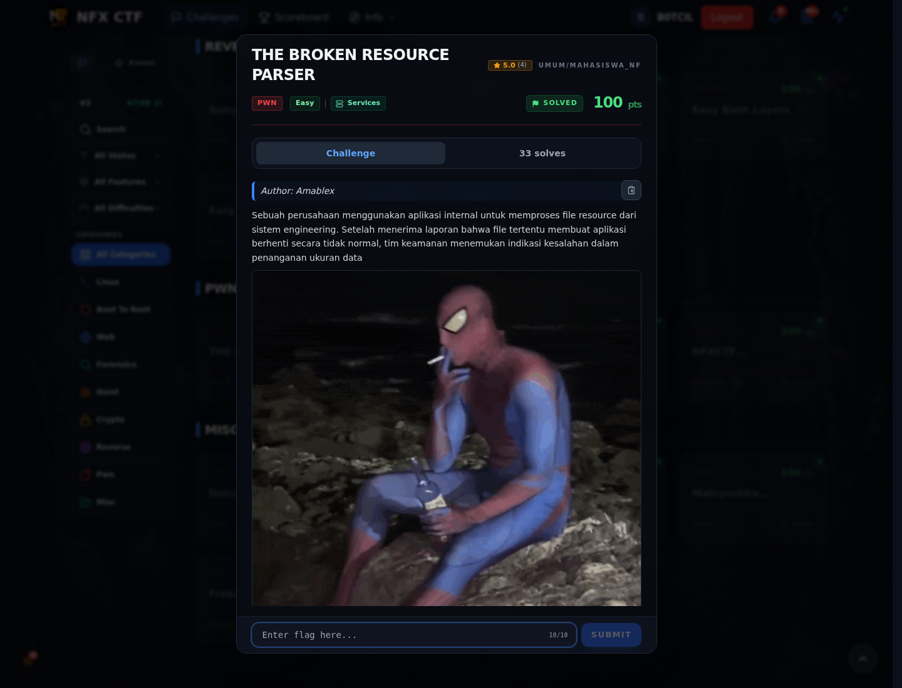

# THE BROKEN RESOURCE PARSER — Referensi

[← Overview](65-the-broken-resource-parser.md) · [Index](index.md)

> **Langkah 5/5 — Referensi.** Parser bug, memory corruption.
>
> **Titik penting:** Parser bug, memory corruption.
>
> **Selesai.** Kembali ke [Overview](65-the-broken-resource-parser.md).

Parser bug, memory corruption.

### Evidence langkah ini

*Challenge brief asli di platform NFX CTF 2026.*
