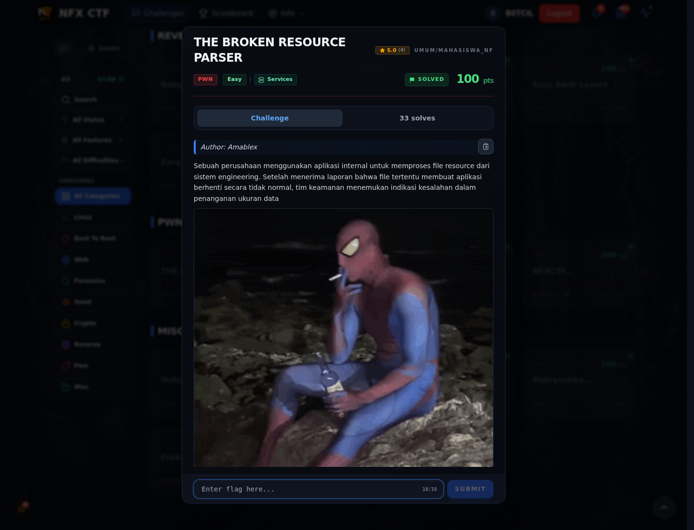
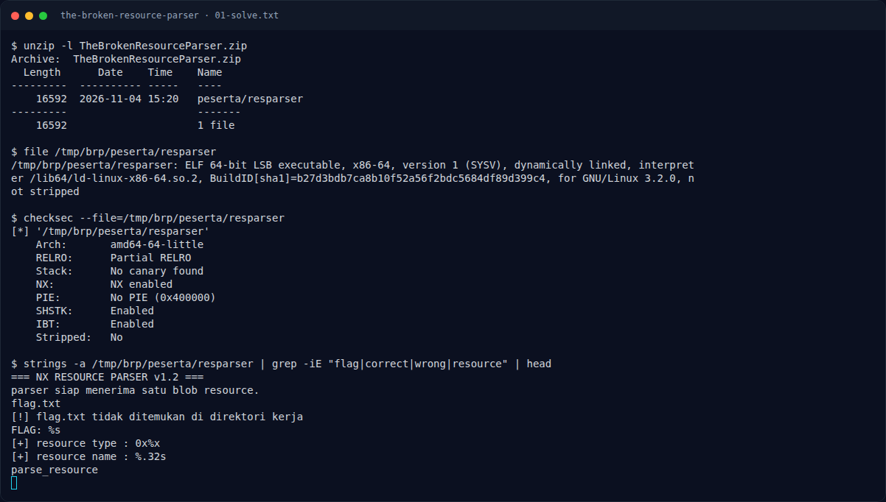

# THE BROKEN RESOURCE PARSER

Track Mahasiswa NF · PwnEasy100 poinVERIFIED

| Field | Nilai |
|---|---|
| Event | `umum/mahasiswa_nf` |
| Kategori | `Pwn` |
| Author | `Amablex` |
| Difficulty | `Easy` |
| Poin (snapshot) | `100` |
| Flag | `NFX{Ad1o0Ssss_Br0k3nnn_fl3gg}` |
| Status | `VERIFIED` |
| Metode | **FULL** — metode utama berhasil direproduksi. |
| Snapshot | 2026-11-13 |

[← Kembali ke Index](index.md)

## TL;DR

- **Flag:** `NFX{Ad1o0Ssss_Br0k3nnn_fl3gg}`
- **Metode:** **FULL** — metode utama berhasil direproduksi.
- **Baca langkah lengkap:** [Cara Mendapatkan Flag](65-the-broken-resource-parser-02-cara-mendapatkan-flag.md)

## Challenge Brief (platform)

*Challenge brief asli di platform NFX CTF 2026.*

## Alur & Titik Penting

| # | Langkah | Titik penting | Buka |
|---:|---|---|---|
| 1 | Recon | ELF non-PIE, `win` di `0x4012ae`. | [Buka](65-the-broken-resource-parser-01-recon.md) |
| 2 | Cara Mendapatkan Flag | Overflow nama, offset `0x38`, ret2win. | [Buka](65-the-broken-resource-parser-02-cara-mendapatkan-flag.md) |
| 3 | Flag | NFX{Ad1o0Ssss_Br0k3nnn_fl3gg} | [Buka](65-the-broken-resource-parser-03-flag.md) |
| 4 | Bukti / Evidence | arsip screenshot dan transkrip | [Buka](65-the-broken-resource-parser-04-bukti-evidence.md) |
| 5 | Referensi | Parser bug, memory corruption. | [Buka](65-the-broken-resource-parser-05-referensi.md) |

## Cerita singkat

Binary non-PIE tanpa canary. `parse_resource` menyalin nama ke buffer 0x30 byte. Padding `0x38` lalu alamat `win` (`0x4012ae`) membaca `flag.txt`.

Pratinjau evidence. Buka halaman <a href="65-the-broken-resource-parser-04-bukti-evidence.html">Evidence / Bukti</a> untuk semua screenshot dan transkrip.

## Navigasi Halaman

<a class="nx-page-card" href="65-the-broken-resource-parser-01-recon.html"><b>Recon</b>Enumerasi target dan bukti awal</a>
<a class="nx-page-card" href="65-the-broken-resource-parser-02-cara-mendapatkan-flag.html"><b>Cara Mendapatkan Flag</b>Flag dan verifikasi platform</a>
<a class="nx-page-card" href="65-the-broken-resource-parser-03-flag.html"><b>Flag</b>Flag dan verifikasi platform</a>
<a class="nx-page-card" href="65-the-broken-resource-parser-04-bukti-evidence.html"><b>Bukti / Evidence</b>Screenshot, transkrip, dan artefak</a>
<a class="nx-page-card" href="65-the-broken-resource-parser-05-referensi.html"><b>Referensi</b>Sumber dan bacaan lanjutan</a>

