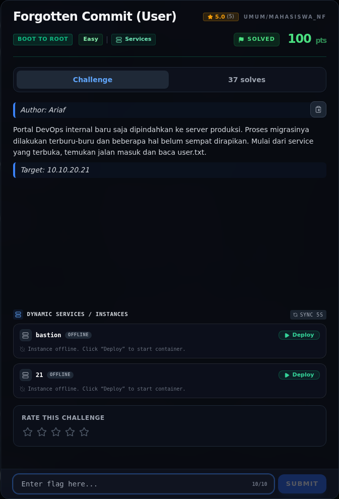

# Forgotten Commit (User) — Recon

[← Overview](66-forgotten-commit-user.md) · [Index](index.md)

> **Langkah 1/5 — Recon.** Target yang stabil adalah `10.10.20.21`, bukan `.20`. `/.git/` terbuka.
>
> **Titik penting:** `http://10.10.20.21/.git/HEAD`
>
> **Berikutnya:** [Cara Mendapatkan Flag](66-forgotten-commit-user-02-cara-mendapatkan-flag.md)

```bash
nmap -Pn -sV -p 22,80 10.10.20.21
curl -sI http://10.10.20.21/.git/HEAD
```

Webroot-nya "Nexus Developer Platform". Langkah dump repo dan kredensial ada di halaman berikutnya.

### Evidence langkah ini



*Challenge brief asli di platform NFX CTF 2026.*
