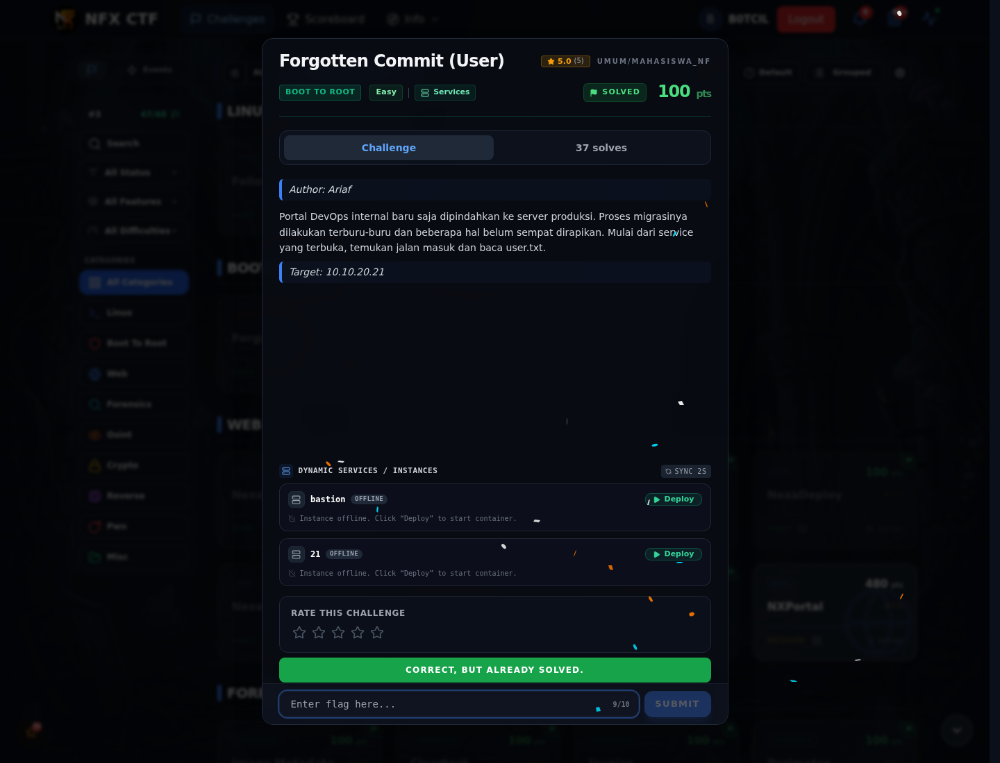

# Forgotten Commit (User) — Flag & Verifikasi

[← Overview](66-forgotten-commit-user.md) · [Index](index.md)

> **Langkah 2/5 — Cara Mendapatkan Flag.** Cara Mendapatkan Flag
>
> **Titik penting:** NFX{g1t_h1story_s3cr3ts_l34d_t0_ssh}
>
> **Berikutnya:** [Flag](66-forgotten-commit-user-03-flag.md)

> **Flag:** `NFX{g1t_h1story_s3cr3ts_l34d_t0_ssh}`
> **Status:** `VERIFIED`

1. Nmap target dan cek webroot:
```bash
nmap -Pn -sV -p 22,80 10.10.20.20
curl -sS -i http://10.10.20.20/.git/HEAD
```
2. Dump repo dengan `git-dumper`, lalu lihat history untuk kredensial.
3. SSH sebagai user, baca `/home/<user>/user.txt`.

### Bukti submit di platform



*Submit flag di platform: `CORRECT, BUT ALREADY SOLVED.`*

> **Bukti submit:** screenshot form challenge di atas menampilkan `CORRECT, BUT ALREADY SOLVED.`
