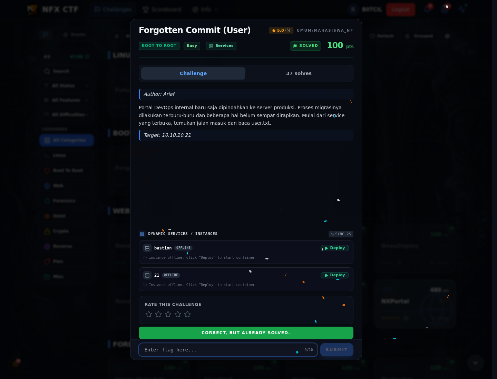

# Forgotten Commit (User) — Flag & Verifikasi

[← Overview](66-forgotten-commit-user.md) · [Index](index.md)

> **Langkah 3/5 — Flag.** Flag
>
> **Titik penting:** NFX{g1t_h1story_s3cr3ts_l34d_t0_ssh}
>
> **Berikutnya:** [Bukti / Evidence](66-forgotten-commit-user-04-bukti-evidence.md)

> **Flag:** `NFX{g1t_h1story_s3cr3ts_l34d_t0_ssh}`
> **Status:** `VERIFIED`

```text
NFX{g1t_h1story_s3cr3ts_l34d_t0_ssh}
```

### Bukti submit di platform



*Submit flag di platform: `CORRECT, BUT ALREADY SOLVED.`*

> **Bukti submit:** screenshot form challenge di atas menampilkan `CORRECT, BUT ALREADY SOLVED.`
