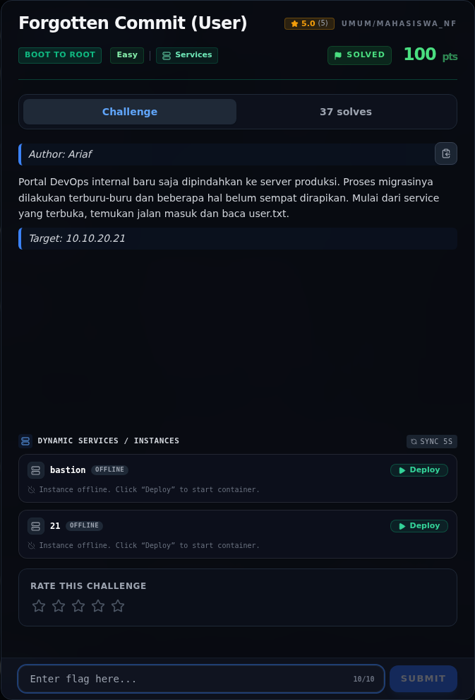

# Forgotten Commit (User) — Referensi

[← Overview](66-forgotten-commit-user.md) · [Index](index.md)

> **Langkah 5/5 — Referensi.** Git exposure, git-dumper, credential leak.
>
> **Titik penting:** Git exposure, git-dumper, credential leak.
>
> **Selesai.** Kembali ke [Overview](66-forgotten-commit-user.md).

Git exposure, git-dumper, credential leak.

### Evidence langkah ini

*Challenge brief asli di platform NFX CTF 2026.*
