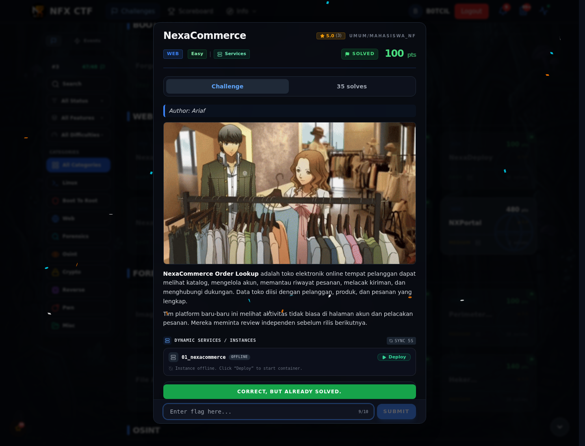

# NexaCommerce — Flag & Verifikasi

[← Overview](67-nexacommerce.md) · [Index](index.md)

> **Langkah 2/5 — Cara Mendapatkan Flag.** Cara Mendapatkan Flag
>
> **Titik penting:** NFX{sql1_un10n_bas3d_4uth_byp4ss}
>
> **Berikutnya:** [Flag](67-nexacommerce-03-flag.md)

> **Flag:** `NFX{sql1_un10n_bas3d_4uth_byp4ss}`
> **Status:** `VERIFIED`

1. Cek form login dan parameter yang masuk ke query.
2. Uji injeksi dengan `' OR 1=1-- -`, lalu sesuaikan jumlah kolom untuk UNION.
3. Setelah session admin, buka halaman admin dan ambil flag.

### Bukti submit di platform

*Submit flag di platform: `CORRECT, BUT ALREADY SOLVED.`*

> **Bukti submit:** screenshot form challenge di atas menampilkan `CORRECT, BUT ALREADY SOLVED.`
