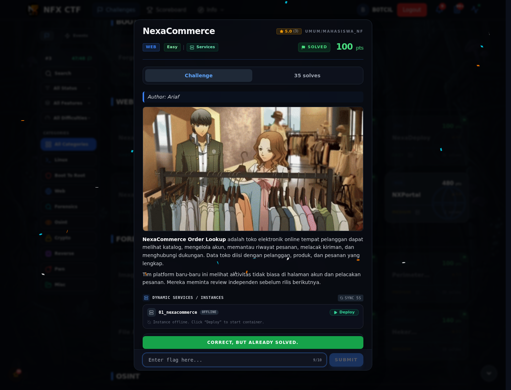

# NexaCommerce — Flag & Verifikasi

[← Overview](67-nexacommerce.md) · [Index](index.md)

> **Langkah 3/5 — Flag.** Flag
>
> **Titik penting:** NFX{sql1_un10n_bas3d_4uth_byp4ss}
>
> **Berikutnya:** [Bukti / Evidence](67-nexacommerce-04-bukti-evidence.md)

> **Flag:** `NFX{sql1_un10n_bas3d_4uth_byp4ss}`
> **Status:** `VERIFIED`

```text
NFX{sql1_un10n_bas3d_4uth_byp4ss}
```

### Bukti submit di platform



*Submit flag di platform: `CORRECT, BUT ALREADY SOLVED.`*

> **Bukti submit:** screenshot form challenge di atas menampilkan `CORRECT, BUT ALREADY SOLVED.`
