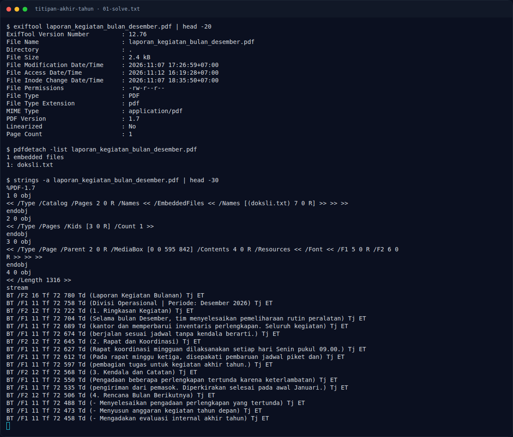

# Titipan Akhir Tahun — Flag & Verifikasi

[← Overview](68-titipan-akhir-tahun.md) · [Index](index.md)

> **Langkah 2/5 — Cara Mendapatkan Flag.** Cara Mendapatkan Flag
>
> **Titik penting:** NFX{D3C0D3_D4ND3C0D3_L4G1}
>
> **Berikutnya:** [Flag](68-titipan-akhir-tahun-03-flag.md)

> **Flag:** `NFX{D3C0D3_D4ND3C0D3_L4G1}`
> **Status:** `VERIFIED`

1. Cek struktur PDF dan metadata:
```bash
exiftool laporan_kegiatan_bulan_desember.pdf
pdfdetach -list laporan_kegiatan_bulan_desember.pdf
```
2. Ekstrak attachment/objek tersembunyi.
3. Decode isi yang masih dibungkus untuk mendapatkan flag.

### Terminal evidence (real)



*Terminal evidence (real).*

> **Bukti:** terminal evidence (real).
