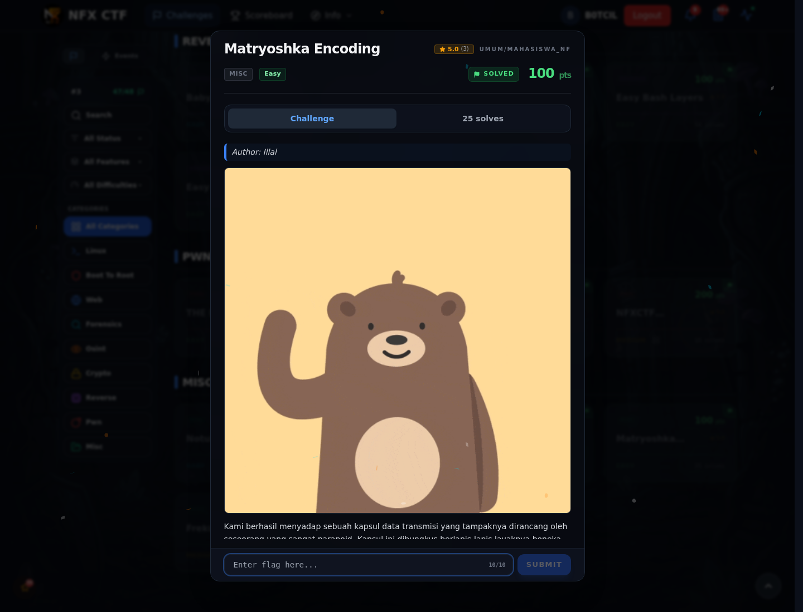

# Matryoshka Encoding — Recon

[← Overview](69-matryoshka-encoding.md) · [Index](index.md)

> **Langkah 1/5 — Recon.** Attachment-nya `capsule.dat`. Panjangnya genap, jadi langkah pertama adalah menukar setiap pasangan byte.
>
> **Titik penting:** `capsule.dat`, panjang genap.
>
> **Berikutnya:** [Cara Mendapatkan Flag](69-matryoshka-encoding-02-cara-mendapatkan-flag.md)

Jangan mulai dari CyberChef "decode berulang". Urutan yang benar: tukar pasangan byte, Base64, zlib, Base85, XOR `NFX!`. Solver lengkap ada di halaman berikutnya.

### Evidence langkah ini

*Challenge brief asli di platform NFX CTF 2026.*
