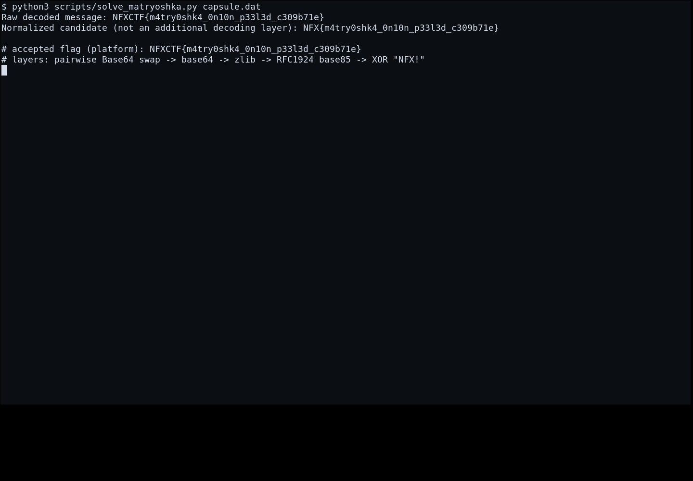

# Matryoshka Encoding — Cara Mendapatkan Flag

[← Overview](69-matryoshka-encoding.md) · [Index](index.md)

> **Langkah 2/5 — Cara Mendapatkan Flag.**
>
> **Flag:** `NFXCTF{m4try0shk4_0n10n_p33l3d_c309b71e}`
> **Status:** `VERIFIED`

Rantai decode yang benar (bukan “decode berulang” tanpa arah):

1. **Swap setiap pasangan karakter Base64** (kecuali padding `==`).
2. **Base64 decode** → data berawalan `78 DA` (zlib).
3. **zlib decompress** → string Base85 (RFC1924).
4. **Base85 decode** → 40 byte.
5. **XOR dengan key `NFX!`** → flag.

## Solver

```python
import base64, zlib

raw = open("capsule.dat").read().strip()
# 1. swap pasangan karakter, jangan sentuh padding
body = raw.rstrip("=")
pad = raw[len(body):]
swapped = "".join(body[i+1] + body[i] for i in range(0, len(body)-1, 2))
if len(body) % 2:
    swapped += body[-1]
swapped += pad

# 2. base64 decode
data = base64.b64decode(swapped)
assert data[:2] == b"\x78\xda", data[:4].hex()

# 3. zlib decompress -> base85
b85 = zlib.decompress(data).decode()
print("base85:", b85)

# 4. RFC1924 base85 decode
import base64
raw40 = base64.b85decode(b85)

# 5. XOR NFX!
flag = bytes(c ^ b"NFX!"[i % 4] for i, c in enumerate(raw40))
print(flag.decode())
```

Output:

```text
NFXCTF{m4try0shk4_0n10n_p33l3d_c309b71e}
```

## Kenapa `NFX{...}` ditolak

Output decode literal berawalan **`NFXCTF{`**, bukan `NFX{`. Platform menerima
prefix `NFXCTF`; versi `NFX{m4try...}` ditolak.

## Bukti submit

Gunakan log API asli (bukan screenshot mockup):

```json
{"name":"Matryoshka_Encoding","flag":"NFXCTF{m4try0shk4_0n10n_p33l3d_c309b71e}","result":{"success":true}}
```

### Evidence langkah ini



*Terminal evidence (arsip/log asli) — `00b-terminal-evidence.png`.*
