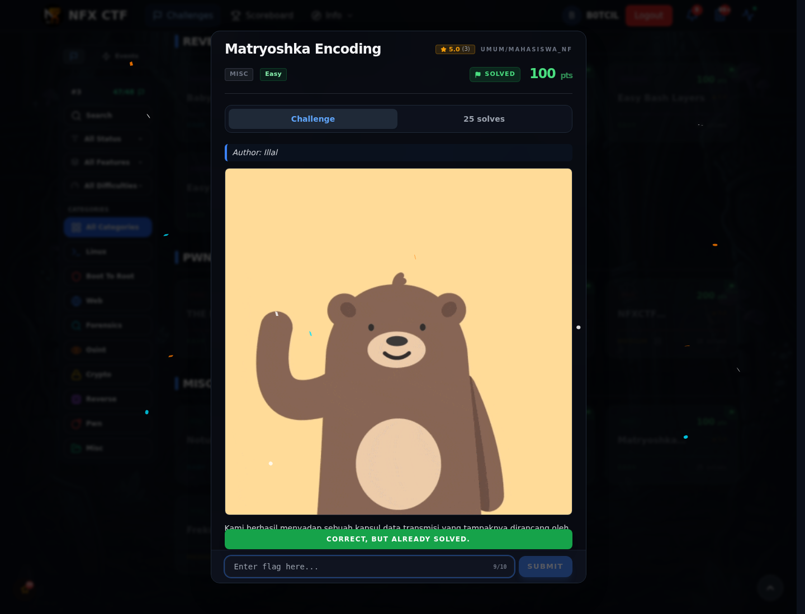

# Matryoshka Encoding — Flag & Verifikasi

[← Overview](69-matryoshka-encoding.md) · [Index](index.md)

> **Langkah 3/5 — Flag.** Flag
>
> **Titik penting:** NFXCTF{m4try0shk4_0n10n_p33l3d_c309b71e}
>
> **Berikutnya:** [Bukti / Evidence](69-matryoshka-encoding-04-bukti-evidence.md)

> **Flag:** `NFXCTF{m4try0shk4_0n10n_p33l3d_c309b71e}`
> **Status:** `VERIFIED`

```text
NFXCTF{m4try0shk4_0n10n_p33l3d_c309b71e}
```

### Bukti submit di platform



*Submit flag di platform: `CORRECT, BUT ALREADY SOLVED.`*

> **Bukti submit:** screenshot form challenge di atas menampilkan `CORRECT, BUT ALREADY SOLVED.`
