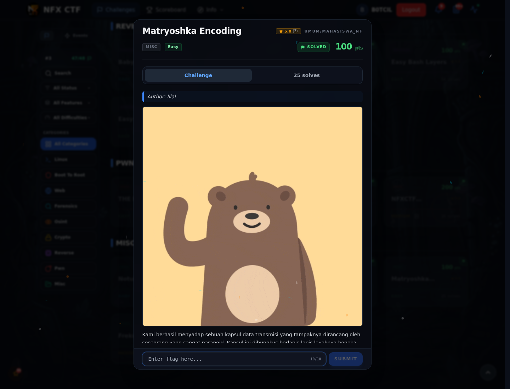

# Matryoshka Encoding — Referensi

[← Overview](69-matryoshka-encoding.md) · [Index](index.md)

> **Langkah 5/5 — Referensi.** Layered encoding, base64, compression.
>
> **Titik penting:** Layered encoding, base64, compression.
>
> **Selesai.** Kembali ke [Overview](69-matryoshka-encoding.md).

Layered encoding, base64, compression.

### Evidence langkah ini

*Challenge brief asli di platform NFX CTF 2026.*
