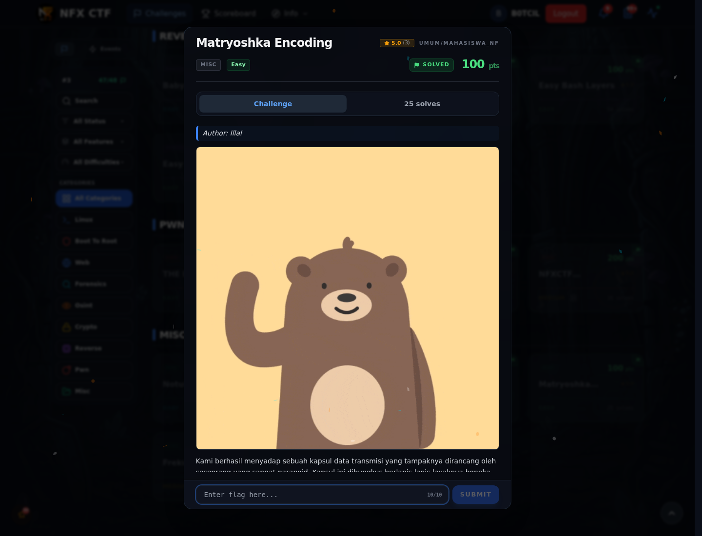
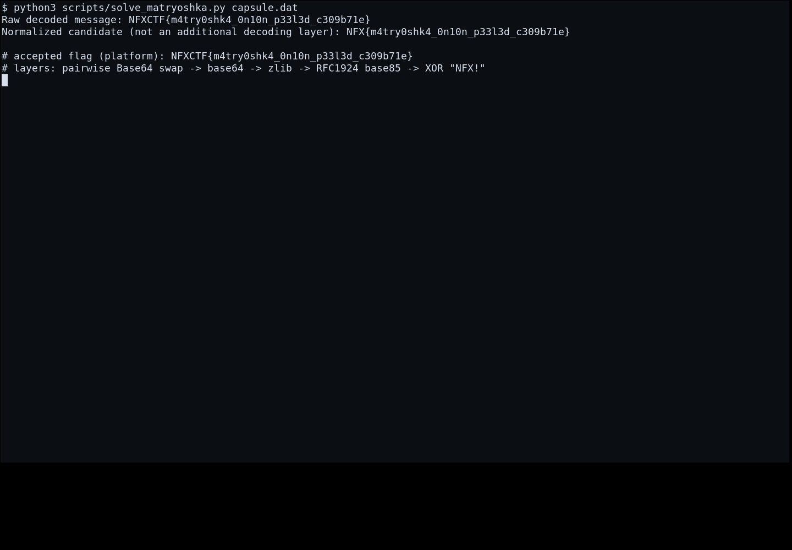

# Matryoshka Encoding

Track Mahasiswa NF · MiscEasy100 poinVERIFIED

| Field | Nilai |
|---|---|
| Event | `umum/mahasiswa_nf` |
| Kategori | `Misc` |
| Author | `Illal` |
| Difficulty | `Easy` |
| Poin | `100` |
| Flag | `NFXCTF{m4try0shk4_0n10n_p33l3d_c309b71e}` |
| Status | `VERIFIED` |
[← Kembali ke Index](index.md)

## TL;DR

- **Flag:** `NFXCTF{m4try0shk4_0n10n_p33l3d_c309b71e}`
- **Baca langkah lengkap:** [Cara Mendapatkan Flag](69-matryoshka-encoding-02-cara-mendapatkan-flag.md)

## Challenge Brief (platform)

*Challenge brief asli di platform NFX CTF 2026.*

## Alur & Titik Penting

| # | Langkah | Titik penting | Buka |
|---:|---|---|---|
| 1 | Recon | capsule.dat`, panjang genap. | [Buka](69-matryoshka-encoding-01-recon.md) |
| 2 | Cara Mendapatkan Flag | NFXCTF{m4try0shk4_0n10n_p33l3d_c309b71e} | [Buka](69-matryoshka-encoding-02-cara-mendapatkan-flag.md) |
| 3 | Flag | NFXCTF{m4try0shk4_0n10n_p33l3d_c309b71e} | [Buka](69-matryoshka-encoding-03-flag.md) |
| 4 | Bukti / Evidence | arsip screenshot dan transkrip | [Buka](69-matryoshka-encoding-04-bukti-evidence.md) |
| 5 | Referensi | Layered encoding, base64, compression. | [Buka](69-matryoshka-encoding-05-referensi.md) |

## Cerita singkat

Namanya Matryoshka: encoding berlapis. Setiap lapisan harus dibuka satu per satu sampai isinya flag.

Pratinjau evidence. Buka halaman <a href="69-matryoshka-encoding-04-bukti-evidence.html">Evidence / Bukti</a> untuk semua screenshot dan transkrip.

## Navigasi Halaman

<a class="nx-page-card" href="69-matryoshka-encoding-01-recon.html"><b>Recon</b>Enumerasi target dan bukti awal</a>
<a class="nx-page-card" href="69-matryoshka-encoding-02-cara-mendapatkan-flag.html"><b>Cara Mendapatkan Flag</b>Flag dan verifikasi platform</a>
<a class="nx-page-card" href="69-matryoshka-encoding-03-flag.html"><b>Flag</b>Flag dan verifikasi platform</a>
<a class="nx-page-card" href="69-matryoshka-encoding-04-bukti-evidence.html"><b>Bukti / Evidence</b>Screenshot, transkrip, dan artefak</a>
<a class="nx-page-card" href="69-matryoshka-encoding-05-referensi.html"><b>Referensi</b>Sumber dan bacaan lanjutan</a>

