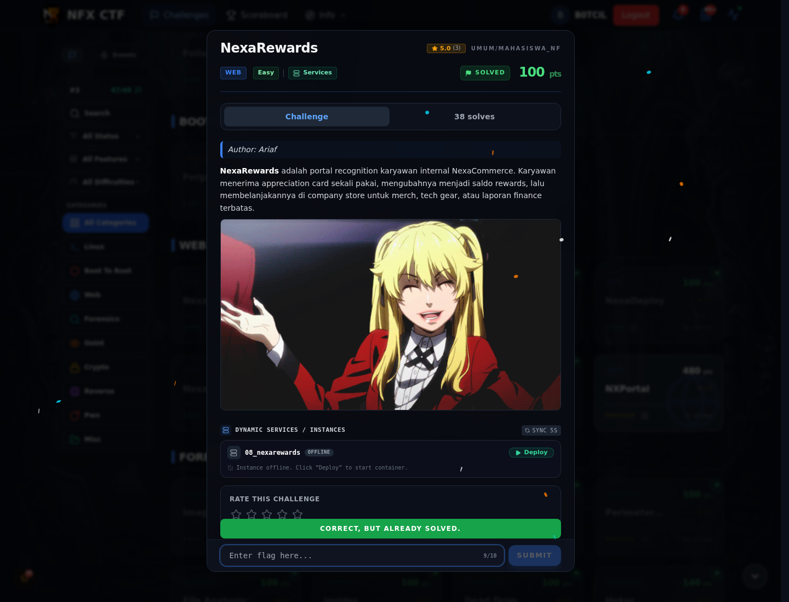

# NexaRewards — Flag & Verifikasi

[← Overview](70-nexarewards.md) · [Index](index.md)

> **Langkah 2/5 — Cara Mendapatkan Flag.** Cara Mendapatkan Flag
>
> **Titik penting:** NFX{r4c3_c0nd1t10n_g1ft_c4rd_d0ubl3_sp3nd}
>
> **Berikutnya:** [Flag](70-nexarewards-03-flag.md)

> **Flag:** `NFX{r4c3_c0nd1t10n_g1ft_c4rd_d0ubl3_sp3nd}`
> **Status:** `VERIFIED`

1. Buat akun dan dapatkan gift card.
2. Kirim beberapa request redeem secara paralel.
3. Kalau saldo bertambah lebih dari sekali, tukar ke item/flag.

### Bukti submit di platform

*Submit flag di platform: `CORRECT, BUT ALREADY SOLVED.`*

> **Bukti submit:** screenshot form challenge di atas menampilkan `CORRECT, BUT ALREADY SOLVED.`
