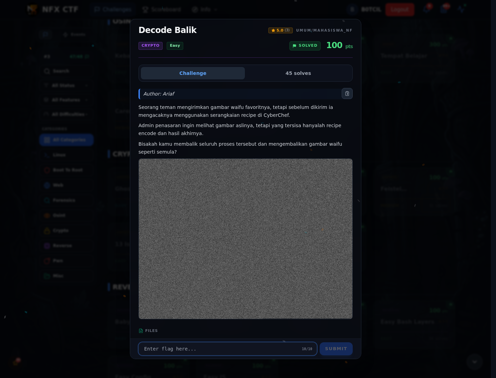

# Decode Balik — Recon

[← Overview](71-decode-balik.md) · [Index](index.md)

> **Langkah 1/5 — Recon.** Baca brief challenge dan cek attachment/service yang diberikan.
>
> **Titik penting:** Baca brief challenge dan cek attachment/service yang diberikan.
>
> **Berikutnya:** [Cara Mendapatkan Flag](71-decode-balik-02-cara-mendapatkan-flag.md)

Baca brief challenge dan cek attachment/service yang diberikan. Catat endpoint, file, atau petunjuk awal sebelum masuk ke langkah berikutnya.

### Evidence langkah ini

*Challenge brief asli di platform NFX CTF 2026.*
