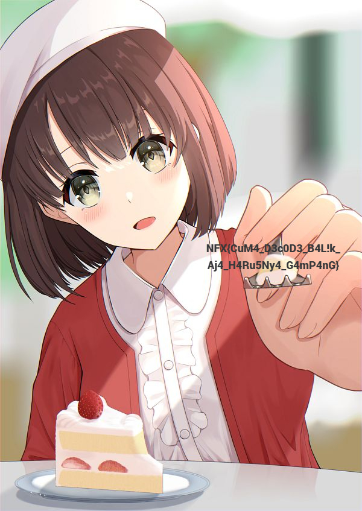
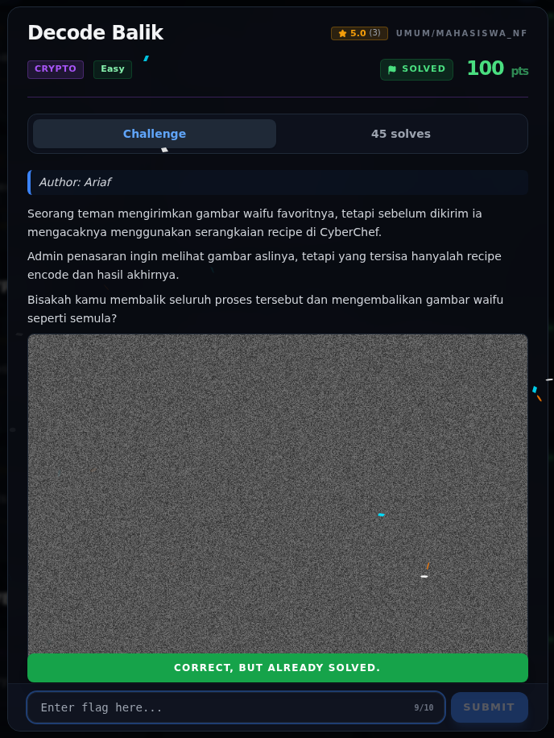

# Decode Balik — Cara Mendapatkan Flag

[← Overview](71-decode-balik.md) · [Index](index.md)

> **Langkah 2/5 — Cara Mendapatkan Flag.** Attachment `waifu.png` menyimpan
> Base64 di kanal merah; decode berlapis menghasilkan JPEG yang memuat flag.
>
> **Flag:** `NFX{CuM4_D3c0D3_B4L!k_Aj4_H4Ru5Ny4_G4mP4nG}`
> **Status:** `VERIFIED` — metode berhasil direproduksi.

## 1. Attachment

```text
waifu.png
PNG 780×586, RGBA, 8-bit
```

Sekilas gambar terlihat seperti noise abu-abu. `R=G=B`, jadi gambar ini
sebenarnya grayscale yang dibungkus PNG RGBA.

## 2. Recon

```bash
file waifu.png
exiftool -a -u -g1 waifu.png
pngcheck -v waifu.png
zsteg waifu.png
```

Tidak ada metadata/teks yang menonjol. Tapi kalau kanal **merah** dibaca
sebagai byte dan dilihat sebagai ASCII, awalnya adalah:

```text
eJzt/cf+gty79A0ekANBQHTQA6IkQSQ7IyhZQEDA...
```

`eJzt` adalah ciri khas **Base64 dari stream zlib** (`78 9c` setelah decode).
Jadi data sebenarnya ada di kanal merah, bukan di metadata.

## 3. Ambil Base64 dari kanal merah

```python
from PIL import Image

im = Image.open("waifu.png").convert("RGBA")
flat = bytes(px[0] for px in im.getdata())  # kanal R
# ambil prefix Base64 terpanjang
import re
b64 = re.match(rb"[A-Za-z0-9+/=]+", flat).group(0)
```

Panjang prefix Base64: **456.752 karakter**.

## 4. Decode berlapis

Urutannya:

```text
Base64 decode  -> zlib stream (342.564 byte)
zlib decompress -> Base64 string (448.720 byte)
Base64 decode  -> JPEG (336.539 byte, header FF D8 FF E0)
```

Setelah JPEG disimpan dan dibuka, flag terlihat tertulis di gambar:

```text
NFX{CuM4_D3c0D3_B4L!k_Aj4_H4Ru5Ny4_G4mP4nG}
```



*JPEG hasil decode; flag tertulis di sisi kanan gambar.*

## 5. Solver lengkap

Tersimpan di [`assets/decode-balik/solve_decode_balik.py`](assets/decode-balik/solve_decode_balik.py):

```python
import base64, re, zlib
from pathlib import Path
from PIL import Image

HERE = Path(__file__).resolve().parent
im = Image.open(HERE / "waifu.png").convert("RGBA")
flat = bytes(px[0] for px in im.getdata())
b64 = re.match(rb"[A-Za-z0-9+/=]+", flat).group(0)
b64 = b64[: len(b64) // 4 * 4]
zlib_data = base64.b64decode(b64)
inner_b64 = zlib.decompress(zlib_data)
jpeg = base64.b64decode(inner_b64)
```

Jalankan dari folder challenge:

```bash
cd docs/assets/decode-balik
python3 solve_decode_balik.py
```

Output:

```text
base64 chars : 456752
zlib bytes   : 342564
inner base64 : 448720
jpeg bytes   : 336539
jpeg header  : ffd8ffe0
saved        : 10-waifu-decoded.jpg
```

## 6. Kenapa recipe CyberChef menyesatkan

Recipe di `challenge.json`:

```text
To Base64 → Zlib Deflate → To Base64 → Generate Image
```

Input contoh di link recipe adalah `TkZYe1JFREVDVEVEfQ` → `NFX{REDECTED}`.
Itu **decoy/contoh**, bukan flag. Attachment asli adalah `waifu.png`, dan
data yang tersimpan di kanal merah adalah hasil encoding dari sebuah **JPEG**,
bukan dari string decoy. Karena itu reverse yang benar adalah membaca kanal
merah → Base64 → zlib → Base64 → JPEG, lalu membaca flag dari JPEG.

## 7. Verifikasi platform



*Screenshot asli platform: `CORRECT, BUT ALREADY SOLVED.`*

### Evidence langkah ini

- [`waifu.png`](assets/decode-balik/waifu.png) — attachment asli.
- [`10-waifu-decoded.jpg`](assets/decode-balik/10-waifu-decoded.jpg) — JPEG hasil decode.
- [`solve_decode_balik.py`](assets/decode-balik/solve_decode_balik.py) — solver.
