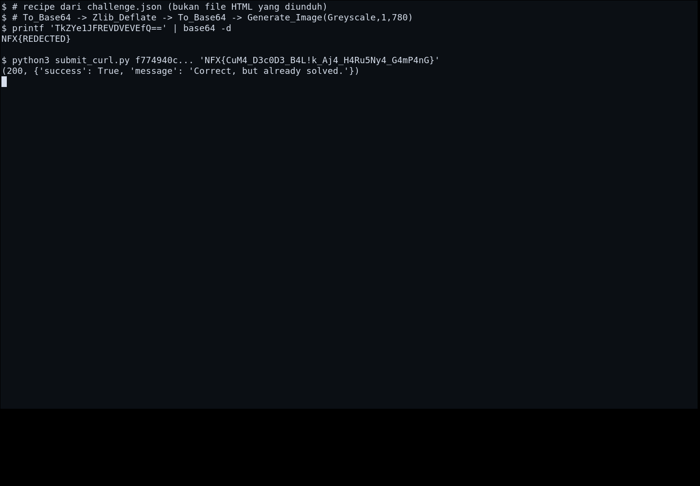
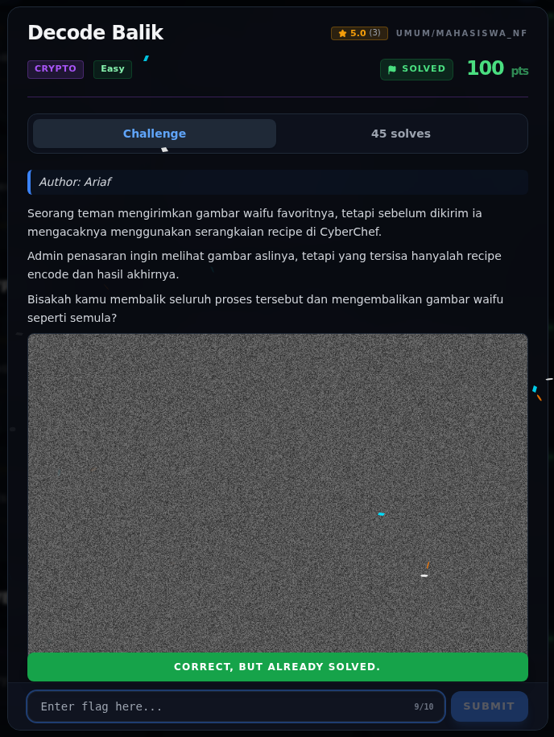

# Decode Balik — Flag & Verifikasi

[← Overview](71-decode-balik.md) · [Index](index.md)

> **Langkah 3/5 — Flag.** Flag
>
> **Titik penting:** NFX{CuM4_D3c0D3_B4L!k_Aj4_H4Ru5Ny4_G4mP4nG}
>
> **Berikutnya:** [Bukti / Evidence](71-decode-balik-04-bukti-evidence.md)

> **Asal flag.** Flag diperoleh dari langkah exploit/solver yang terdokumentasi, lalu disubmit ke platform.  
> **Tingkat bukti metode.** Terdokumentasi. [Buka Evidence](71-decode-balik-04-bukti-evidence.md)

> **Flag:** `NFX{CuM4_D3c0D3_B4L!k_Aj4_H4Ru5Ny4_G4mP4nG}`
> **Status:** `VERIFIED`

```text
NFX{CuM4_D3c0D3_B4L!k_Aj4_H4Ru5Ny4_G4mP4nG}
```

### Terminal evidence (real)



*Terminal evidence (real).*

> **Bukti:** terminal evidence (real).

## Validasi platform (real)



*Screenshot asli dari platform NFX CTF 2026. Platform menjawab
`CORRECT, BUT ALREADY SOLVED.` untuk flag ini.*
