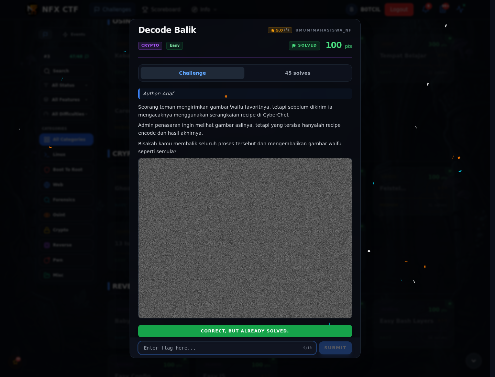

# Decode Balik — Evidence / Bukti

2 screenshot0 transkrip / script

[← Overview](71-decode-balik.md) · [Index](index.md)

> **Langkah 4/5 — Bukti / Evidence.** Bukti / Evidence
>
> **Titik penting:** arsip screenshot dan transkrip
>
> **Berikutnya:** [Referensi](71-decode-balik-05-referensi.md)

## Arsip Evidence

> Semua file berasal dari `assets/decode-balik/`. Screenshot platform dan terminal adalah bukti asli dari sesi solve; transkrip mentah tetap ditautkan di bagian bawah.

### Platform

<figure><figcaption>00-challenge-platform.png</figcaption></figure>

*Challenge brief asli di platform NFX CTF 2026.*

<figure><figcaption>00b-submit-platform.png</figcaption></figure>

*Submit flag di platform: `CORRECT, BUT ALREADY SOLVED.`*

## Tabel Evidence

- Challenge brief: `assets/decode-balik/00-challenge-platform.png`
- Submit web: `assets/decode-balik/00b-submit-platform.png`
- Catatan mentah: lihat folder `assets/decode-balik/`