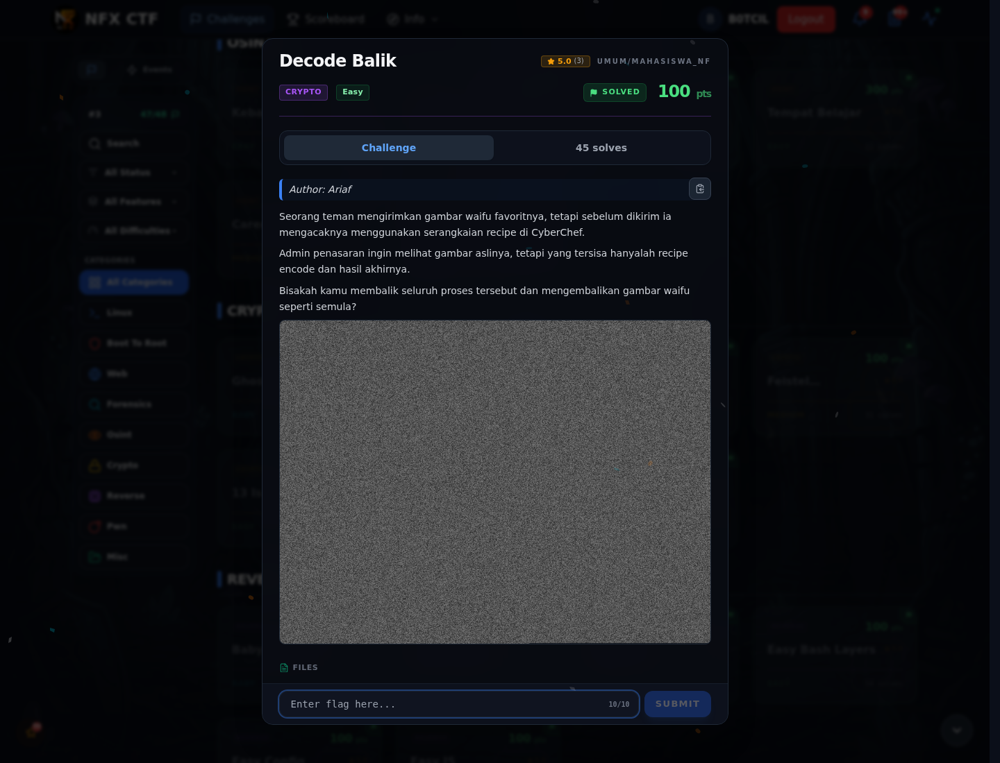
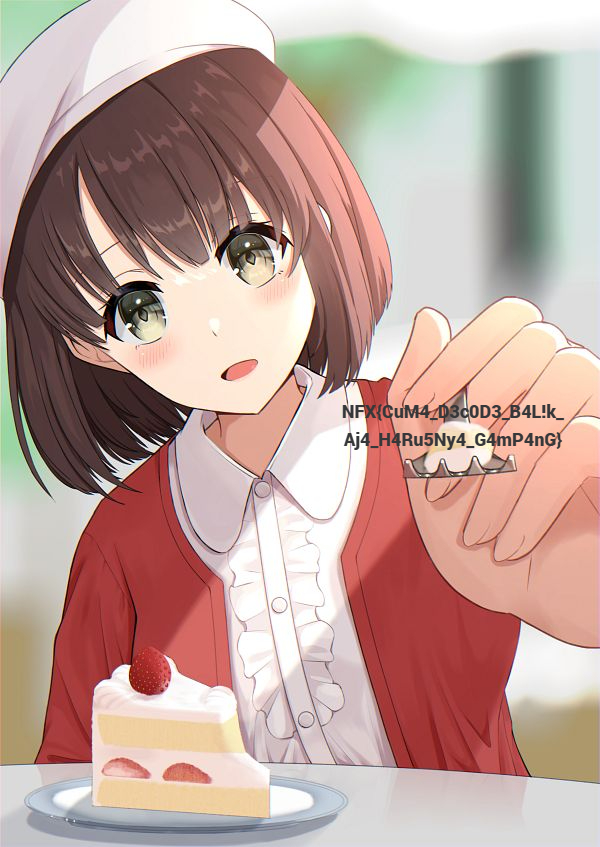

# Decode Balik — Evidence / Bukti

3 screenshot1 script

[← Overview](71-decode-balik.md) · [Index](index.md)

> **Langkah 4/5 — Bukti / Evidence.** Bukti / Evidence
>
> **Titik penting:** arsip screenshot dan transkrip
>
> **Berikutnya:** [Referensi](71-decode-balik-05-referensi.md)

## Arsip Evidence

> Semua file berasal dari `assets/decode-balik/`. Screenshot platform dan terminal adalah bukti asli dari sesi solve; transkrip mentah tetap ditautkan di bagian bawah.

### Platform

<figure><figcaption>00-challenge-platform.png</figcaption></figure>

*Challenge brief asli di platform NFX CTF 2026.*

<figure><figcaption>Terminal evidence (real)</figcaption></figure>

*Terminal evidence (real).*

<figure><figcaption>10-waifu-decoded.jpg</figcaption></figure>

*JPEG hasil decode `waifu.png`; flag tertulis di sisi kanan gambar.*

## Validasi platform (real)

*Screenshot asli dari platform NFX CTF 2026. Platform menjawab
`CORRECT, BUT ALREADY SOLVED.` untuk flag ini.*

## Tabel Evidence

- Challenge brief: `assets/decode-balik/00-challenge-platform.png`
- Terminal evidence: `assets/decode-balik/00b-terminal-evidence.png`
- Attachment asli: `assets/decode-balik/waifu.png`
- JPEG hasil decode: `assets/decode-balik/10-waifu-decoded.jpg`
- Solver: `assets/decode-balik/solve_decode_balik.py`
- Validasi platform: `assets/decode-balik/00b-platform-validation.png`