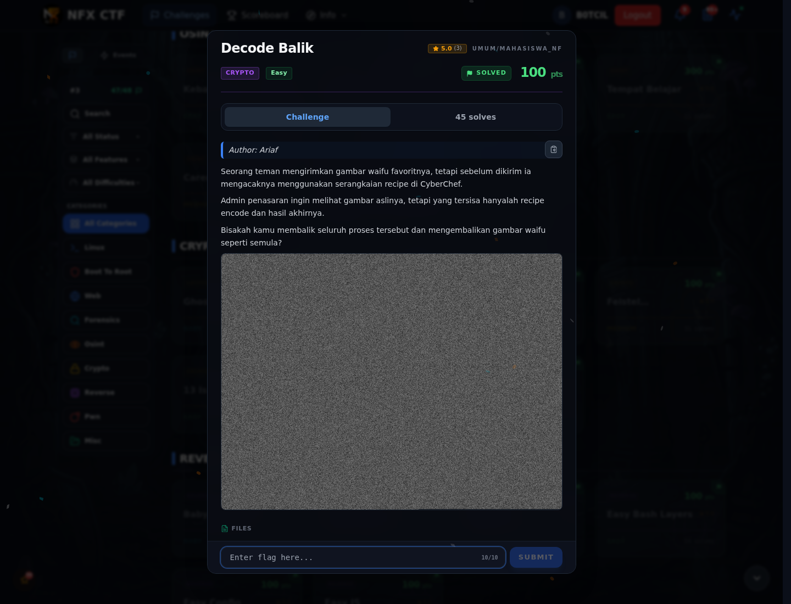
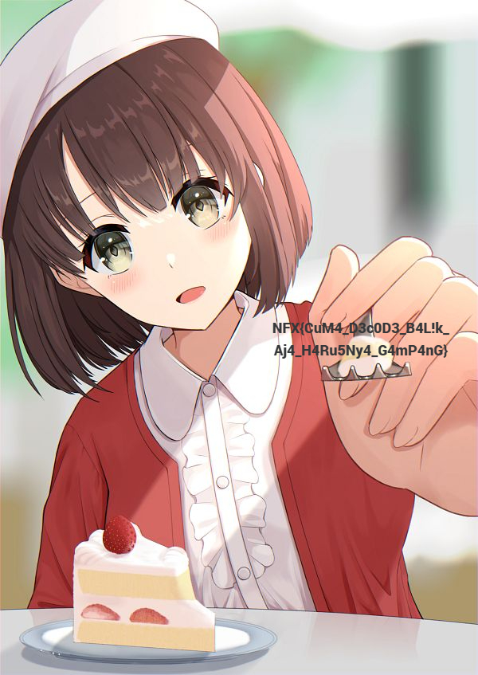

# Decode Balik

Track Mahasiswa NF · CryptoEasy100 poinVERIFIED

| Field | Nilai |
|---|---|
| Event | `umum/mahasiswa_nf` |
| Kategori | `Crypto` |
| Author | `Ariaf` |
| Difficulty | `Easy` |
| Poin (snapshot) | `100` |
| Flag | `NFX{CuM4_D3c0D3_B4L!k_Aj4_H4Ru5Ny4_G4mP4nG}` |
| Status | `VERIFIED` |
| Metode | **FULL** — Decode berlapis dari kanal merah `waifu.png` berhasil direproduksi sampai JPEG yang memuat flag. |
| Snapshot | 2026-11-13 |

[← Kembali ke Index](index.md)

## TL;DR

- **Flag:** `NFX{CuM4_D3c0D3_B4L!k_Aj4_H4Ru5Ny4_G4mP4nG}`
- **Metode:** **FULL** — Decode berlapis dari kanal merah waifu.png berhasil direproduksi sampai JPEG yang memuat flag.
- **Baca langkah lengkap:** [Cara Mendapatkan Flag](71-decode-balik-02-cara-mendapatkan-flag.md)

## Challenge Brief (platform)

*Challenge brief asli di platform NFX CTF 2026.*

## Alur & Titik Penting

| # | Langkah | Titik penting | Buka |
|---:|---|---|---|
| 1 | Recon | To Base64` → `Zlib Deflate` → `To Base64` → `Generate Image`. | [Buka](71-decode-balik-01-recon.md) |
| 2 | Cara Mendapatkan Flag | NFX{CuM4_D3c0D3_B4L!k_Aj4_H4Ru5Ny4_G4mP4nG} | [Buka](71-decode-balik-02-cara-mendapatkan-flag.md) |
| 3 | Flag | NFX{CuM4_D3c0D3_B4L!k_Aj4_H4Ru5Ny4_G4mP4nG} | [Buka](71-decode-balik-03-flag.md) |
| 4 | Bukti / Evidence | arsip screenshot dan transkrip | [Buka](71-decode-balik-04-bukti-evidence.md) |
| 5 | Referensi | CyberChef recipe reversing. | [Buka](71-decode-balik-05-referensi.md) |

## Cerita singkat

Attachment `waifu.png` terlihat seperti noise, tetapi kanal merahnya menyimpan Base64. Decode berlapis (Base64 → zlib → Base64) menghasilkan JPEG yang memuat flag. Recipe CyberChef di brief memakai input decoy, jadi bukan jalur utama.

Pratinjau evidence. Buka halaman <a href="71-decode-balik-04-bukti-evidence.html">Evidence / Bukti</a> untuk semua screenshot dan transkrip.

## Navigasi Halaman

<a class="nx-page-card" href="71-decode-balik-01-recon.html"><b>Recon</b>Enumerasi target dan bukti awal</a>
<a class="nx-page-card" href="71-decode-balik-02-cara-mendapatkan-flag.html"><b>Cara Mendapatkan Flag</b>Flag dan verifikasi platform</a>
<a class="nx-page-card" href="71-decode-balik-03-flag.html"><b>Flag</b>Flag dan verifikasi platform</a>
<a class="nx-page-card" href="71-decode-balik-04-bukti-evidence.html"><b>Bukti / Evidence</b>Screenshot, transkrip, dan artefak</a>
<a class="nx-page-card" href="71-decode-balik-05-referensi.html"><b>Referensi</b>Sumber dan bacaan lanjutan</a>

