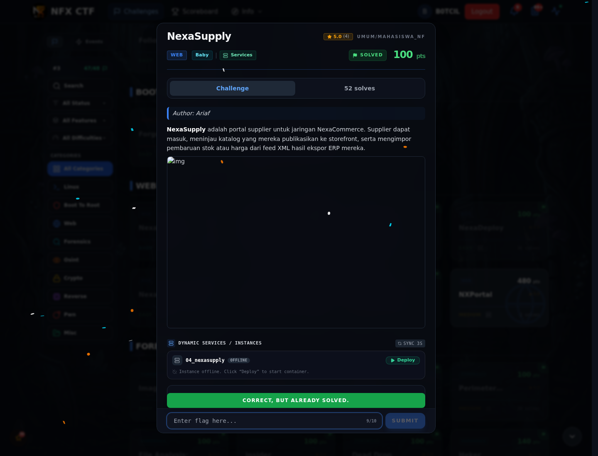

# NexaSupply — Flag & Verifikasi

[← Overview](72-nexasupply.md) · [Index](index.md)

> **Langkah 2/5 — Cara Mendapatkan Flag.** Cara Mendapatkan Flag
>
> **Titik penting:** NFX{xxe_supply_f33d_l0c4l_f1l3_r34d}
>
> **Berikutnya:** [Flag](72-nexasupply-03-flag.md)

> **Flag:** `NFX{xxe_supply_f33d_l0c4l_f1l3_r34d}`
> **Status:** `VERIFIED`

1. Cari endpoint yang menerima XML.
2. Kirim XML dengan `<!ENTITY xxe SYSTEM "file:///flag.txt">`.
3. Pakai entity di response untuk membaca flag.

### Bukti submit di platform

*Submit flag di platform: `CORRECT, BUT ALREADY SOLVED.`*

> **Bukti submit:** screenshot form challenge di atas menampilkan `CORRECT, BUT ALREADY SOLVED.`
