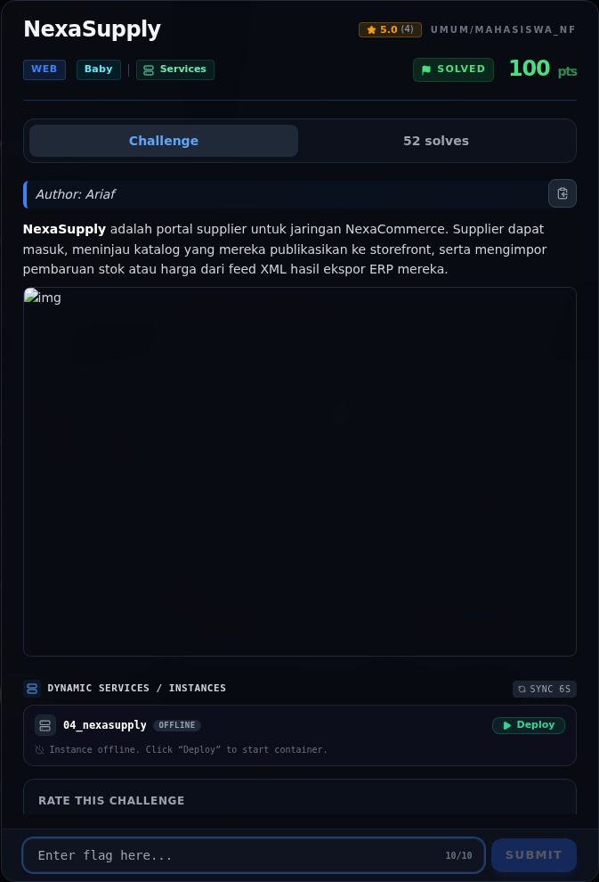

# NexaSupply — Referensi

[← Overview](72-nexasupply.md) · [Index](index.md)

> **Langkah 5/5 — Referensi.** XXE, external entity, local file read.
>
> **Titik penting:** XXE, external entity, local file read.
>
> **Selesai.** Kembali ke [Overview](72-nexasupply.md).

XXE, external entity, local file read.

### Evidence langkah ini

*Challenge brief asli di platform NFX CTF 2026.*
